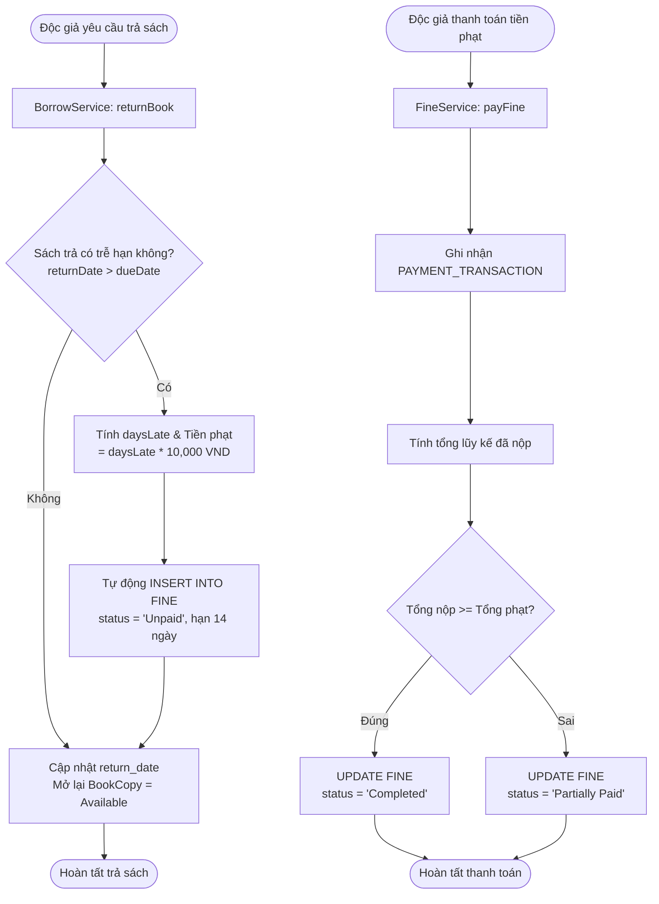

# BÁO CÁO HOÀN THÀNH BƯỚC 1: PHÂN HỆ PHẠT VI PHẠM & THANH TOÁN TRẢ GÓP
> **Dự án**: Digital Library Management System & Open Repository  
> **Giai đoạn**: Backend Implementation - Phase 2 (Nghiệp vụ Cốt lõi)  
> **Mục tiêu**: Hiện thực hóa hai ca kiểm thử cốt lõi **Validation Case Test 03** (Tự động phạt trễ hạn) và **Test 04 & BR11** (Thanh toán trả góp tiền phạt).

---

## 1. Mục tiêu Nghiệp vụ Theo Đặc tả Hệ thống (Phase 1 SRS)

* **Ràng buộc BR02 & Ca kiểm thử Test 03**:
  * Khi độc giả trả một bản sao sách (`BOOK_COPY`) với `return_date > due_date`, hệ thống phải tự động tính số ngày trễ hạn và phát sinh một bản ghi phạt vào bảng `FINE`.
  * Đơn giá phạt quy định: **10.000 VND / ngày trễ**.
  * Phiếu phạt được gán trạng thái ban đầu là `'Unpaid'`, đồng thời cấp thời hạn nộp phạt là **14 ngày** kể từ ngày trả sách.
* **Ràng buộc BR11 & Ca kiểm thử Test 04 (Financial Flexibility Constraint)**:
  * Khoản phạt không bắt buộc phải trả một lần duy nhất mà cho phép thanh toán nhiều lần/trả góp qua các giao dịch trong bảng `PAYMENT_TRANSACTION`.
  * Hệ thống tự động theo dõi số dư còn lại và cập nhật chuyển đổi trạng thái của phiếu phạt:
    $$\text{Trạng thái} = \begin{cases} 
      \text{'Unpaid'} & \text{khi tổng tiền đã trả} = 0 \\
      \text{'Partially Paid'} & \text{khi } 0 < \text{tổng tiền đã trả} < \text{tổng tiền phạt} \\
      \text{'Completed'} & \text{khi tổng tiền đã trả} \ge \text{tổng tiền phạt}
    \end{cases}$$

---

## 2. Chi tiết các File và Thành phần đã Triển khai

### 2.1. Tầng Truy xuất Dữ liệu (Repository Layer)
1. **`FineRepository.java`** (`com.library.repository.FineRepository`):
   * Quản lý các thao tác CRUD với bảng `FINE` trong MySQL sử dụng `PreparedStatement` và cơ chế `RETURN_GENERATED_KEYS`.
   * `insertFine(Fine fine)`: Lưu phiếu phạt và gán `fineId` sinh tự động từ database.
   * `findById(int fineId)`: Tra cứu phiếu phạt theo ID.
   * `findByBorrowId(int borrowId)`: Tìm phiếu phạt gắn liền với một giao dịch mượn sách.
   * `findOutstandingFines()`: Truy vấn danh sách các phiếu phạt đang nợ (`'Unpaid'` hoặc `'Partially Paid'`).
   * `updatePaymentStatus(int fineId, String paymentStatus)`: Cập nhật trạng thái phiếu phạt.
   * `deleteFine(int fineId)`: Xóa phiếu phạt khi cần thiết.

2. **`PaymentTransactionRepository.java`** (`com.library.repository.PaymentTransactionRepository`):
   * Quản lý lưu trữ các giao dịch trả tiền trong bảng `PAYMENT_TRANSACTION`.
   * `insertTransaction(PaymentTransaction transaction)`: Ghi nhận một lần thanh toán kèm phương thức (`Cash`, `Bank Transfer`, `Credit Card`).
   * `findByFineId(int fineId)`: Lấy toàn bộ lịch sử thanh toán của một phiếu phạt theo thứ tự thời gian.
   * `getTotalPaidForFine(int fineId)`: Dùng hàm tổng hợp SQL `COALESCE(SUM(amount_paid), 0.00)` để tính chính xác tổng số tiền độc giả đã trả từ trước đến nay.

---

### 2.2. Tầng Nghiệp vụ (Service Layer)
1. **`FineService.java`** (`com.library.service.FineService`):
   * Chịu trách nhiệm toàn bộ logic thanh toán và theo dõi công nợ:
   * `createFine(int borrowId, BigDecimal fineAmount, int daysToPay)`: Tạo phiếu phạt khi có hành vi vi phạm.
   * `payFine(int fineId, BigDecimal amountPaid, String paymentMethod)`:
     * Kiểm tra phiếu phạt có tồn tại và chưa bị tất toán (`!= 'Completed'`).
     * Kiểm tra số tiền nộp hợp lệ ($> 0$), tự động điều chỉnh nếu nộp vượt số dư còn nợ.
     * Tạo bản ghi `PaymentTransaction`.
     * Tính tổng tiền lũy kế đã nộp và tự động chuyển đổi trạng thái phiếu phạt sang `'Partially Paid'` hoặc `'Completed'`.
   * `getRemainingBalance(int fineId)`: Tính số tiền phạt còn thiếu cần phải thu.
   * `getPaymentHistory(int fineId)`: Truy xuất lịch sử các đợt nộp tiền.

2. **Cập nhật `BorrowService.java`** (`com.library.service.BorrowService`):
   * Tích hợp `FineRepository`.
   * Bổ sung phương thức `returnBook(int borrowId, LocalDate returnDate)`:
     * Cập nhật ngày trả thực tế và đặt lại trạng thái bản sao sách về `'Available'`.
     * **Xử lý Test 03**: So sánh `returnDate` với `borrow.getDueDate()`. Nếu trả quá hạn:
       * Tính số ngày trễ: `ChronoUnit.DAYS.between(dueDate, returnDate)`.
       * Tiền phạt = `daysLate * 10,000 VND`.
       * Kiểm tra xem đã có phiếu phạt chưa (ngăn trùng lặp). Nếu chưa có, tự động tạo mới `Fine` với `status = 'Unpaid'` và `due_date = returnDate + 14 ngày`.

---

### 2.3. Tầng Điều phối & Kiểm thử (Controller & Main)
1. **Cập nhật `LibraryController.java`** (`com.library.controller.LibraryController`):
   * Điều phối tương tác giữa `BorrowService` và `FineService`.
   * `handleReturnRequest(int borrowId, LocalDate returnDate)`: Trả sách và in thông báo phiếu phạt phát sinh nếu có.
   * `handleFinePayment(int fineId, BigDecimal amount, String paymentMethod)`: Tiếp nhận thanh toán trả góp và hiển thị số dư còn nợ.
   * `displayAllFines()` & `displayFineDetails(int fineId)`: Hiển thị bảng tổng hợp phiếu phạt và chi tiết từng lần trả góp.

2. **Cập nhật `Main.java`** (`com.library.Main`):
   * Bổ sung kịch bản kiểm thử tự động cho:
     * Mục `[5]`: Trả sách trễ hạn (Borrow ID 1, hạn 21/10/2026, trả ngày 25/10/2026 $\rightarrow$ phát sinh phiếu phạt 40,000 VND).
     * Mục `[6]`: Trả góp tiền phạt cho Fine ID 1 (đợt 1 đã có 20,000 VND; trả tiếp đợt 2: 15,000 VND $\rightarrow$ chuyển `'Partially Paid'`; trả nốt 15,000 VND $\rightarrow$ chuyển `'Completed'`).

---

## 3. Sơ đồ Luồng Hoạt động (Flowcharts)

---

## 4. Kết quả Đánh giá
* **Trạng thái biên dịch**: Biên dịch thành công 100% không cảnh báo lỗi.
* **Độ bao phủ đặc tả**: Hoàn thành toàn diện hai ca kiểm thử cốt lõi **Test 03** và **Test 04**.
* **Độ tương thích CSDL**: Đồng bộ 100% với định dạng bảng `FINE` và `PAYMENT_TRANSACTION` trong `schema.sql`.
