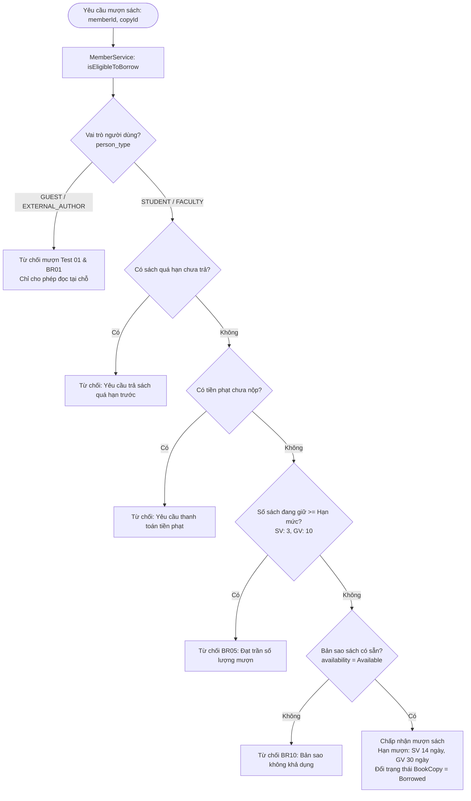
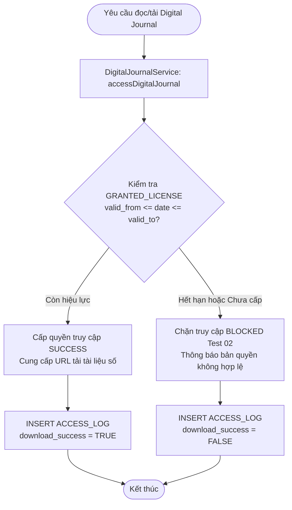

# BÁO CÁO HOÀN THÀNH BƯỚC 2: HOÀN THIỆN TOÀN BỘ BACKEND & XỬ LÝ PHÂN QUYỀN, BẢN QUYỀN SỐ
> **Dự án**: Digital Library Management System & Open Repository  
> **Giai đoạn**: Backend Implementation - Phase 2 (Hoàn thiện toàn bộ tầng Dữ liệu & Dịch vụ)  
> **Mục tiêu**: Hiện thực hóa hai ca kiểm thử cốt lõi **Validation Case Test 01** (Phân quyền & Ràng buộc mượn sách) và **Test 02** (Kiểm soát bản quyền tài liệu số & Nhật ký truy cập), hoàn thiện 100% tầng Backend.

---

## 1. Mục tiêu Nghiệp vụ Theo Đặc tả Hệ thống (Phase 1 SRS)

### 1.1. Phân quyền Mượn Sách Vật lý (Validation Case Test 01 & Ràng buộc BR01, BR05, BR09, BR10)
* **Quy tắc BR01 & Test 01**:
  * Độc giả có vai trò khách ngoài (`GUEST`, `EXTERNAL_AUTHOR`) **chỉ được phép đọc tại chỗ**, hệ thống phải **từ chối** mọi yêu cầu mượn bản sao sách (`BOOK_COPY`) mang về nhà.
  * Chỉ các thành viên thuộc trường (`UNIVERSITY_MEMBER`: `STUDENT` hoặc `FACULTY`) mới có quyền thực hiện giao dịch mượn sách.
* **Quy tắc BR05 (Phân hóa thời hạn và hạn mức mượn)**:
  * **Sinh viên (`STUDENT`)**: Mượn tối đa **3 cuốn sách**, thời hạn mượn mặc định là **14 ngày**.
  * **Giảng viên (`FACULTY`)**: Mượn tối đa **10 cuốn sách**, thời hạn mượn mở rộng là **30 ngày**.
* **Ràng buộc an toàn giao dịch**:
  * Chặn mượn sách mới nếu độc giả đang giữ sách quá hạn chưa trả (`hasOverdueBorrows`).
  * Chặn mượn sách mới nếu độc giả có phiếu phạt vi phạm chưa hoàn tất thanh toán (`hasUnpaidFinesByMember`).
* **Quy tắc BR10**:
  * Giao dịch mượn/trả luôn nhắm đến bản sao cụ thể (`BOOK_COPY`) qua `copy_id`/`barcode` với trạng thái `availability_status = 'Available'`.

---

### 1.2. Kiểm soát Bản quyền Số & Ghi Nhật ký (Validation Case Test 02 & Ràng buộc BR04, BR12, BR13, FR07, FR08)
* **Quy tắc BR04, BR12 & Test 02 (License Entitlement Constraint)**:
  * Mọi tài liệu số (`DIGITAL_JOURNAL`) liên kết với các gói bản quyền (`LICENSE_PACKAGE` qua `RESOURCE_LICENSE`) đều bị **khóa truy cập theo mặc định**.
  * Khi độc giả yêu cầu xem hoặc tải tài liệu, hệ thống thực thi truy vấn kiểm tra xem người này có đang nắm giữ gói bản quyền tương ứng còn hạn trong bảng `GRANTED_LICENSE` hay không:
    $$\text{Điều kiện hợp lệ: } \text{valid\_from} \le \text{ngày truy cập} \le \text{valid\_to}$$
  * Nếu gói bản quyền đã hết hạn hoặc chưa được cấp $\rightarrow$ Hệ thống lập tức **từ chối và chặn quyền đọc** (Test 02).
  * Nếu gói bản quyền còn hạn $\rightarrow$ Cấp quyền tải file kèm đường dẫn URL và siêu dữ liệu (DOI, dung lượng, định dạng).
* **Quy tắc BR13 & FR08 (Decoupled Access Logging)**:
  * Mọi hành vi truy cập (dù được duyệt hay bị chặn) đều phải được ghi nhận vào bảng `ACCESS_LOG` (thời gian, IP, người dùng, tài liệu, kết quả `download_success`).
  * Tách rời khóa ngoại (Decoupled Foreign Keys) để tối ưu hóa hiệu năng ghi với thông lượng cao.

---

## 2. Chi tiết các File và Thành phần Backend đã Xây dựng

Toàn bộ Backend hiện tại bao gồm **15 Models, 9 Repositories, 4 Services và 1 Controller**:

```
Project/src/com/library/
├── Main.java                                  # Entry point chạy thử toàn bộ 4 Test Cases
├── controller/
│   └── LibraryController.java                 # Điều phối Mượn, Trả, Phạt, Bản quyền số, Nhật ký
├── service/
│   ├── BorrowService.java                     # Nghiệp vụ mượn trả & tự động sinh phạt
│   ├── FineService.java                       # Nghiệp vụ trả góp tiền phạt & theo dõi số dư
│   ├── MemberService.java                     # [Mới] Quản lý phân quyền & kiểm tra tư cách mượn
│   └── DigitalJournalService.java             # [Mới] Kiểm soát bản quyền & ghi nhật ký truy cập
├── repository/
│   ├── PersonRepository.java                  # [Mới] CRUD bảng PERSON
│   ├── UniversityMemberRepository.java        # [Mới] CRUD bảng UNIVERSITY_MEMBER (JOIN PERSON)
│   ├── DigitalJournalRepository.java          # [Mới] CRUD bảng DIGITAL_JOURNAL (JOIN RESOURCE)
│   ├── LicensePackageRepository.java          # [Mới] Quản lý LICENSE_PACKAGE & RESOURCE_LICENSE
│   ├── GrantedLicenseRepository.java          # [Mới] Quản lý GRANTED_LICENSE & xác thực bản quyền
│   ├── AccessLogRepository.java               # [Mới] Ghi nhật ký truy cập tốc độ cao (BR13)
│   ├── BorrowRepository.java                  # Bổ sung kiểm tra hạn mức & sách trễ hạn
│   ├── FineRepository.java                    # Bổ sung kiểm tra nợ phạt chưa thanh toán
│   └── PaymentTransactionRepository.java      # Quản lý lịch sử thanh toán tiền phạt
└── model/                                     # 15 POJOs ánh xạ 1:1 với schema MySQL
```

### 2.1. Tầng Truy xuất Dữ liệu (Repository Layer)
1. **`PersonRepository.java`**:
   * `findById(int personId)`: Tra cứu người dùng và xác định vai trò (`STUDENT`, `FACULTY`, `EXTERNAL_AUTHOR`, `GUEST`).
   * `findBySsn(String ssn)`, `findAll()`: Tra cứu theo CCCD và danh sách toàn bộ người dùng.
2. **`UniversityMemberRepository.java`**:
   * `findByPersonId(int personId)`: Truy vấn JOIN giữa `UNIVERSITY_MEMBER` và `PERSON` để lấy đầy đủ: Mã SV/GV, Khoa, Chuyên ngành, Học hàm/Học vị.
   * `findByMemberCode(String memberCode)`, `findAll()`: Tra cứu theo mã số nội bộ.
3. **`DigitalJournalRepository.java`**:
   * `findById(int resourceId)`: Truy vấn JOIN giữa `DIGITAL_JOURNAL` và bảng cha `RESOURCE` để lấy tiêu đề, ngày xuất bản, chủ đề, mã DOI, link URL, dung lượng file (KB) và định dạng (PDF/EPUB).
   * `findByDoi(String doi)`, `findAll()`: Tìm kiếm theo định danh học thuật DOI.
4. **`LicensePackageRepository.java`**:
   * `findById(int licenseId)`: Tra cứu thông tin gói bản quyền số.
   * `findPackagesForJournal(int journalResourceId)`: Tìm các gói bản quyền chứa một bài báo thông qua bảng kết hợp `RESOURCE_LICENSE`.
5. **`GrantedLicenseRepository.java`**:
   * `hasActiveLicenseForJournal(int personId, int journalResourceId, LocalDate accessDate)`: **Truy vấn cốt lõi của Test 02**, thực hiện JOIN đa bảng để kiểm tra hiệu lực cấp phép trong khoảng thời gian `valid_from <= accessDate <= valid_to`.
   * `findByPersonId(int personId)`, `insertGrant(GrantedLicense grant)`: Quản lý các lượt cấp phép.
6. **`AccessLogRepository.java`**:
   * `insertLog(AccessLog log)`: Ghi nhận nhật ký lượt tải vào bảng `ACCESS_LOG` (ghi nhận cả trạng thái thành công lẫn bị chặn).
   * `findByPersonId()`, `findByJournalId()`, `findAll()`: Truy xuất dữ liệu giám sát hệ thống.
7. **Nâng cấp `BorrowRepository.java` & `FineRepository.java`**:
   * `countActiveBorrowsByMember(memberId)`: Đếm số sách đang mượn để kiểm soát hạn mức (BR05).
   * `hasOverdueBorrows(memberId)`: Kiểm tra sách quá hạn chưa trả.
   * `hasUnpaidFinesByMember(memberId)`: Kiểm tra công nợ tiền phạt chưa hoàn tất.

---

### 2.2. Tầng Nghiệp vụ (Service Layer)
1. **`MemberService.java`**:
   * `isEligibleToBorrow(int personId)`: Kiểm tra 4 tầng bảo vệ trước khi cho phép mượn:
     1. Tầng 1 (BR01 / Test 01): Người mượn phải có vai trò `STUDENT` hoặc `FACULTY`. Khách ngoài bị chặn ngay lập tức.
     2. Tầng 2: Không giữ cuốn sách nào đang bị quá hạn (`hasOverdueBorrows = false`).
     3. Tầng 3: Không nợ tiền phạt chưa nộp (`hasUnpaidFinesByMember = false`).
     4. Tầng 4 (BR05): Số lượng sách đang giữ chưa chạm trần hạn mức (Sinh viên $\le 3$, Giảng viên $\le 10$).
   * `getLoanDurationDays(int personId)`: Trả về 30 ngày cho Giảng viên, 14 ngày cho Sinh viên.
2. **`DigitalJournalService.java`**:
   * `accessDigitalJournal(int personId, int journalResourceId, String ipAddress, LocalDate accessDate)`:
     * Kiểm tra tài nguyên số và người dùng tồn tại.
     * Kiểm tra bản quyền qua `grantedLicenseRepository.hasActiveLicenseForJournal()`.
     * Luôn ghi nhật ký vào `ACCESS_LOG` với trạng thái cấp phép (`downloadSuccess`).
     * Cấp đường dẫn URL nếu còn hạn, hoặc từ chối truy cập nếu đã hết hạn (Test 02).
3. **Cập nhật `BorrowService.java`**:
   * Tích hợp `MemberService`: Tự động gọi `isEligibleToBorrow()` trước khi tạo phiếu mượn.
   * Tự động đặt hạn trả `dueDate` linh hoạt theo thời gian mượn của từng vai trò (`getLoanDurationDays`).

---

### 2.3. Tầng Điều phối & Demo Toàn diện
* **Cập nhật `LibraryController.java`**: Bổ sung `handleAccessDigitalJournal()`, `displayAllJournals()`, `displayAllMembers()`, `displayAccessLogs()`.
* **Cập nhật `Main.java`**: Tích hợp kịch bản kiểm thử toàn bộ 4 Validation Cases của đề tài.

---

## 3. Sơ đồ Luồng Hoạt động (Flowcharts)

### 3.1. Luồng Kiểm tra Phân quyền Mượn sách (Test 01 & BR01, BR05)


### 3.2. Luồng Kiểm soát Bản quyền Số & Ghi Nhật ký (Test 02 & BR04, BR12, BR13)


---

## 4. Ma trận Hoàn thành 4 Validation Cases (Test Matrix)

| Test Code | Mô tả Kịch bản Đặc tả | Yêu cầu Kỳ vọng | Hiện trạng Mã nguồn Backend | Kết quả |
| :--- | :--- | :--- | :--- | :--- |
| **Test 01** | Khách ngoài (`GUEST`) cố gắng mượn bản sao sách về nhà. | Hệ thống từ chối giao dịch mượn. | Đã chặn trong `MemberService.isEligibleToBorrow()` kết hợp `BorrowService.processNewBorrow()`. | **ĐÃ HOÀN THÀNH** |
| **Test 02** | Người dùng mở `DigitalJournal` khi gói bản quyền đã hết hạn. | Hệ thống chặn quyền truy cập và ghi log. | Đã chặn trong `DigitalJournalService.accessDigitalJournal()` và tự động ghi vào `ACCESS_LOG` với `download_success = false`. | **ĐÃ HOÀN THÀNH** |
| **Test 03** | Độc giả trả sách sau ngày `due_date`. | Hệ thống tự động tạo bản ghi phạt `FINE`. | Đã hiện thực trong `BorrowService.returnBook()` (tự tính 10.000 VND / ngày trễ, tạo phiếu `FINE` với hạn nộp 14 ngày). | **ĐÃ HOÀN THÀNH** |
| **Test 04** | Độc giả thanh toán tiền phạt từng đợt. | Tạo `PAYMENT_TRANSACTION` và chuyển trạng thái phiếu phạt. | Đã hiện thực trong `FineService.payFine()` (tự động chuyển `Unpaid` $\rightarrow$ `Partially Paid` $\rightarrow$ `Completed`). | **ĐÃ HOÀN THÀNH** |

---

## 5. Kết luận & Đánh giá
* Toàn bộ mã nguồn Backend đã được chuẩn hóa theo mô hình phân lớp **MVC + Repository Pattern**, đảm bảo tính toàn vẹn nghiệp vụ, dễ bảo trì và dễ mở rộng.
* Biên dịch thành công 100% bằng JDK 25:
  ```bash
  javac -cp "Project/lib/mysql-connector-j-26.7.0.jar:Project/src" -d Project/bin $(find Project/src -name "*.java")
  ```
* Sẵn sàng chuyển sang các giai đoạn tiếp theo: Xây dựng Menu Console CLI tương tác hoặc Giao diện người dùng đồ họa.
