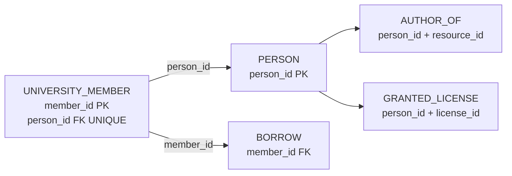
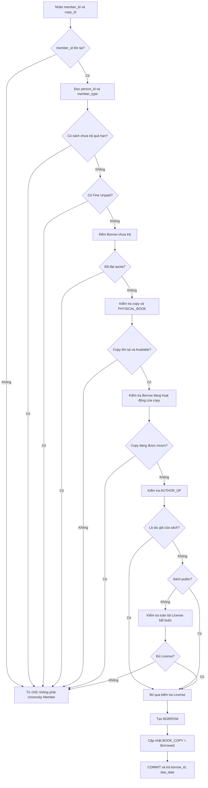
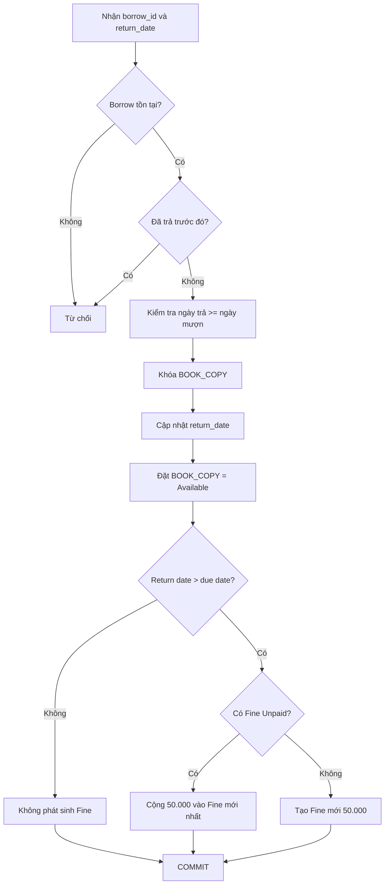

# LUỒNG HOẠT ĐỘNG — DIGITAL LIBRARY MANAGEMENT SYSTEM & OPEN REPOSITORY

> **Phiên bản:** Cập nhật Access Log — lưu Person ID tùy chọn và IP giả lập ngẫu nhiên theo mỗi lượt truy cập (`library_db`)  
> **Nền tảng SQL:** MySQL 8.0+  
> **Phạm vi:** ERD, ràng buộc dữ liệu, Stored Procedures, Views và dữ liệu mẫu trong bộ SQL cập nhật.  
> **Lưu ý:** Tài liệu phân biệt **hành vi đang được triển khai trong SQL** với **quy tắc nghiệp vụ đã được xác nhận** khi phát hiện hai phần chưa đồng nhất.

---

## 1. Tổng quan mô hình dữ liệu

Database được chia thành các nhóm nghiệp vụ chính:

| Nhóm | Bảng | Vai trò |
|---|---|---|
| Danh tính và thành viên | `PERSON`, `UNIVERSITY_MEMBER` | Lưu danh tính cá nhân và tư cách thành viên trường |
| Tài nguyên | `RESOURCE`, `PHYSICAL_BOOK`, `DIGITAL_JOURNAL` | Quản lý thông tin chung và phân loại tài nguyên thông qua bảng subtype |
| Bản sao sách | `BOOK_COPY` | Quản lý từng bản vật lý có thể được mượn |
| Tác giả | `AUTHOR_OF` | Liên kết Person với tài nguyên mà người đó là tác giả |
| License | `LICENSE_PACKAGE`, `RESOURCE_LICENSE`, `GRANTED_LICENSE` | Quản lý License được yêu cầu và License đã cấp cho Person |
| Mượn trả | `BORROW` | Lưu giao dịch mượn sách của University Member |
| Tiền phạt và thanh toán | `FINE`, `PAYMENT_TRANSACTION` | Quản lý khoản phạt và lịch sử xác nhận thanh toán |
| Nhật ký truy cập | `ACCESS_LOG` | Lưu các lượt truy cập journal được chấp thuận, Person ID nếu có và IP giả lập ngẫu nhiên |

### 1.1. Phân biệt `member_id` và `person_id`

Đây là nguyên tắc quan trọng nhất của mô hình mới:

- `PERSON.person_id`: định danh một cá nhân trong hệ thống.
- `UNIVERSITY_MEMBER.member_id`: mã thành viên riêng, độc lập với `person_id`.
- `UNIVERSITY_MEMBER.person_id`: FK `NOT NULL`, `UNIQUE` trỏ đến `PERSON.person_id`.
- `BORROW.member_id`: FK trỏ đến `UNIVERSITY_MEMBER.member_id`.
- Khi kiểm tra tác giả hoặc License, hệ thống đi từ `member_id` sang `UNIVERSITY_MEMBER.person_id`, sau đó tra `AUTHOR_OF` hoặc `GRANTED_LICENSE`.

Vì vậy, **giao dịch mượn sử dụng `member_id`; kiểm tra danh tính, tác giả và License sử dụng `person_id`**. Không được truyền nhầm `person_id` vào vị trí `member_id` của `sp_borrow_book`.



### 1.2. Phân loại thành viên

`UNIVERSITY_MEMBER.member_type` có hai giá trị:

| `member_type` | Thuộc tính bắt buộc | Thuộc tính còn lại |
|---|---|---|
| `STUDENT` | `major` | `academic_rank` được phép NULL hoặc có giá trị |
| `FACULTY` | `academic_rank` | `major` được phép NULL hoặc có giá trị |

Hai thuộc tính `major` và `academic_rank` có thể cùng có dữ liệu. Ví dụ, sinh viên làm trợ giảng vẫn có thể có `academic_rank`; giảng viên từng học tại trường có thể có `major`.

Ràng buộc `CHECK` trong `UNIVERSITY_MEMBER` chỉ bắt buộc thuộc tính tương ứng với `member_type` phải có dữ liệu; nó không cấm thuộc tính còn lại có dữ liệu.

### 1.3. Phân loại tài nguyên

`RESOURCE` lưu thông tin chung gồm `resource_id`, `title`, `topic`, `is_public`. Loại tài nguyên được xác định qua bảng subtype:

- Có bản ghi trong `PHYSICAL_BOOK`: tài nguyên là sách vật lý.
- Có bản ghi trong `DIGITAL_JOURNAL`: tài nguyên là journal số.
- `BOOK_COPY` chỉ tham chiếu đến `PHYSICAL_BOOK`, không tham chiếu trực tiếp đến `RESOURCE`.

`RESOURCE.resource_type` và `RESOURCE.publish_date` không còn tồn tại.

> **Giới hạn ràng buộc hiện tại:** FK bảo đảm mỗi bản ghi subtype phải có `RESOURCE` cha, nhưng schema chưa có constraint bắt buộc mọi `RESOURCE` phải thuộc đúng một subtype, hoặc cấm một `resource_id` đồng thời xuất hiện ở cả hai subtype. Quy tắc này cần được kiểm soát thêm ở tầng ứng dụng hoặc bằng trigger nếu muốn bắt buộc tuyệt đối.

### 1.4. Tác giả

Không còn thực thể `EXTERNAL_AUTHOR` và không còn thuộc tính `PERSON.person_type`.

Mọi cá nhân trong `PERSON` đều có thể là tác giả. Quan hệ tác giả chỉ được xác định bằng cặp:

```text
AUTHOR_OF(person_id, resource_id)
```

Một Person là tác giả của tài nguyên cụ thể khi cặp `person_id` và `resource_id` đó tồn tại trong `AUTHOR_OF`.

---

## 2. Quy tắc License

Có ba nhóm bảng:

- `LICENSE_PACKAGE`: danh mục các gói License.
- `RESOURCE_LICENSE`: những License mà một tài nguyên yêu cầu.
- `GRANTED_LICENSE`: những License đã được cấp cho một Person.

Một tài nguyên private có thể yêu cầu nhiều License. Người truy cập/mượn theo nhánh License phải có **đầy đủ tất cả** License được khai báo trong `RESOURCE_LICENSE` cho tài nguyên đó.

Hàm `fn_has_all_required_licenses(person_id, resource_id)` thực hiện phép kiểm tra này:

1. Đếm tổng số License được yêu cầu bởi tài nguyên.
2. Đếm số License phân biệt mà Person đã được cấp và trùng với các License yêu cầu.
3. Chỉ trả về TRUE khi hai số lượng bằng nhau.
4. Nếu tài nguyên không khai báo License nào, hàm trả về FALSE. Các Procedure gọi hàm phải xử lý riêng trường hợp này.

### 2.1. Cấp License

Procedure: `sp_grant_license_manual`

Đầu vào:

- `p_person_id`: người nhận License.
- `p_license_id`: gói License cần cấp.

Luồng xử lý:

1. Kiểm tra hai tham số không NULL.
2. Kiểm tra Person đã sở hữu gói License đó chưa.
3. Nếu đã tồn tại cặp `(person_id, license_id)`, phát sinh lỗi trùng License.
4. Nếu chưa có, thêm vào `GRANTED_LICENSE`.
5. Trả về `grant_id` mới qua tham số OUT.

Ràng buộc UNIQUE `(person_id, license_id)` cũng ngăn việc cấp trùng ở mức database.

### 2.2. Thu hồi License

Procedure: `sp_revoke_license_manual`

Đầu vào là `p_person_id` và `p_license_id`.

1. Xóa bản ghi `GRANTED_LICENSE` đúng theo cặp Person và License.
2. Trả về số dòng bị xóa qua `p_deleted`.
3. Nếu cặp không tồn tại, số dòng bị xóa bằng 0.

Lưu ý: Procedure thao tác theo cặp `person_id + license_id`, không nhận `grant_id`.

---

## 3. Luồng mượn sách — BORROW

### 3.1. Điều kiện nghiệp vụ

Chỉ `UNIVERSITY_MEMBER` được mượn sách. Một Person không có bản ghi tương ứng trong `UNIVERSITY_MEMBER` không thể tạo Borrow.

Quota và thời hạn mượn:

| Loại thành viên | Số sách đang mượn tối đa | Thời hạn |
|---|---:|---:|
| `STUDENT` | 3 | 14 ngày |
| `FACULTY` | 10 | 30 ngày |

Trước khi cho mượn, hệ thống kiểm tra theo thứ tự:

1. `member_id` được cung cấp phải tồn tại trong `UNIVERSITY_MEMBER`.
2. Thành viên không có sách chưa trả đã quá hạn (`return_date IS NULL` và `due_date < CURDATE()`).
3. Thành viên không có Fine nào ở trạng thái `Unpaid`.
4. Số Borrow chưa trả phải nhỏ hơn quota theo `member_type`.
5. `copy_id` phải tồn tại, thuộc một `PHYSICAL_BOOK` và đang có trạng thái `Available`.
6. Không được tồn tại Borrow chưa trả khác sử dụng cùng `copy_id`.
7. Nếu sách private và người mượn không phải tác giả của chính tài nguyên đó, người mượn phải có đầy đủ License bắt buộc.

Tác giả của chính cuốn sách được bỏ qua **chỉ bước kiểm tra License**. Tư cách University Member, quota, quá hạn, Fine chưa thanh toán và tình trạng bản sao vẫn phải đáp ứng.

### 3.2. Luồng xử lý



### 3.3. Procedure thực thi giao dịch

Procedure: `sp_borrow_book`

```text
IN  p_member_id  VARCHAR(20)
IN  p_copy_id    VARCHAR(30)
OUT p_borrow_id  INT
OUT p_due_date   DATE
```

Procedure thực hiện trong transaction:

1. Khóa dòng `UNIVERSITY_MEMBER` tương ứng bằng `FOR UPDATE` để tuần tự hóa thao tác kiểm tra quota của cùng một thành viên.
2. Lấy `person_id` và `member_type` từ Member.
3. Kiểm tra quá hạn, Fine Unpaid và quota.
4. Khóa bản sao sách bằng `FOR UPDATE`.
5. Kiểm tra trạng thái bản sao và giao dịch mượn chưa trả.
6. Kiểm tra tác giả qua `AUTHOR_OF(person_id, resource_id)`.
7. Kiểm tra License nếu tài nguyên private và người mượn không phải tác giả.
8. Tạo `BORROW` với `borrow_date = CURDATE()` và `due_date` theo loại thành viên.
9. Cập nhật `BOOK_COPY.availability_status = 'Borrowed'`.
10. COMMIT; nếu phát sinh SQL exception, transaction được ROLLBACK.

### 3.4. Procedure kiểm tra trước

`sp_check_resource_access` có nhánh `BORROW_BOOK` để kiểm tra trước điều kiện thành viên, quota, quá hạn, Fine và quyền License ở cấp `resource_id`.

Đây chỉ là kiểm tra trước (preflight), không thay thế `sp_borrow_book`:

- Procedure kiểm tra trước nhận `p_person_id`, không nhận `member_id`.
- Nó xác định `member_id` qua `UNIVERSITY_MEMBER.person_id`.
- Nó không nhận `copy_id`, nên không kiểm tra được một bản sao cụ thể có đang Available hay không.
- `sp_borrow_book` vẫn phải kiểm tra lại trong transaction và khóa dữ liệu trước khi tạo giao dịch.

---

## 4. Luồng trả sách — RETURN

Procedure: `sp_return_book`

```text
IN  p_borrow_id   INT
IN  p_return_date DATE
OUT p_fine_id     INT
OUT p_fine_amount DECIMAL(12,2)
```

Nếu `p_return_date` là NULL, Procedure sử dụng ngày hiện tại (`CURDATE()`).

### 4.1. Các bước xử lý

1. Tìm và khóa Borrow theo `borrow_id`.
2. Nếu không tìm thấy Borrow, trả lỗi.
3. Nếu `return_date` đã có giá trị, từ chối trả lần thứ hai.
4. Ngày trả không được trước `borrow_date`.
5. Khóa bản sao sách tương ứng.
6. Cập nhật `BORROW.return_date`.
7. Đặt `BOOK_COPY.availability_status = 'Available'`.
8. Nếu ngày trả trễ hơn `due_date`, phát sinh khoản phạt 50.000.
9. Nếu không có khoản phạt mới, hai tham số OUT `p_fine_id` và `p_fine_amount` giữ giá trị 0.

### 4.2. Cộng dồn Fine

Khi trả trễ, Procedure tìm Fine mới nhất của Borrow hiện tại có `payment_status = 'Unpaid'`:

- **Đã có Fine Unpaid:** cộng thêm 50.000 vào `total_fine_amount` của Fine đó và trả lại `fine_id`, tổng tiền mới.
- **Không có Fine Unpaid:** tạo một dòng `FINE` mới với số tiền 50.000 và trạng thái `Unpaid`.
- Trường hợp các Fine cũ đã `Completed`, Procedure tạo Fine mới, không sửa lịch sử đã thanh toán.

Mỗi lần trả trễ hiện áp dụng mức phạt cố định 50.000; Procedure chưa tính phạt theo số ngày trễ.



---

## 5. Luồng thanh toán Fine

Procedure: `sp_confirm_fine_payment`

```text
IN  p_fine_id        INT
OUT p_transaction_id INT
```

Các bước:

1. Khóa Fine theo `fine_id`.
2. Nếu Fine không tồn tại, trả lỗi.
3. Nếu trạng thái đã là `Completed`, từ chối thanh toán lần nữa.
4. Thêm một dòng vào `PAYMENT_TRANSACTION` với `payment_date = CURRENT_TIMESTAMP`.
5. Cập nhật `FINE.payment_status = 'Completed'`.
6. COMMIT và trả `transaction_id`.

### Ý nghĩa mô hình thanh toán

- Database hiện lưu `fine_id` và thời điểm xác nhận thanh toán.
- Không còn trường số tiền đã thanh toán hoặc phương thức thanh toán trong `PAYMENT_TRANSACTION`.
- Procedure hiện xác nhận thanh toán toàn bộ Fine, không hỗ trợ thanh toán một phần.
- Nếu một Borrow có nhiều Fine, mỗi Fine được thanh toán độc lập.
- Một Fine đã Completed không được thanh toán lại.

---

## 6. Luồng truy cập Digital Journal — ACCESS

Procedure thực thi: `sp_access_digital_journal`  
Procedure kiểm tra trước: `sp_check_resource_access` với `p_action = 'READ_DIGITAL'`

```text
IN  p_person_id   INT       -- PERSON.person_id; NULL nghĩa là không nhập ID
IN  p_resource_id INT       -- resource_id của DIGITAL_JOURNAL
OUT p_allowed     BOOLEAN
OUT p_reason      VARCHAR(255)
OUT p_log_id      BIGINT
```

**Không còn tham số `p_ip_address`.** Ứng dụng không gửi IP thật đến database. Khi một lượt truy cập được chấp thuận, Stored Procedure tự sinh một địa chỉ IP giả lập ngẫu nhiên và ghi vào Access Log. Vì vậy, IP trong log không phải IP mạng của người dùng và không được lấy từ thiết bị hay tài khoản Person.

`p_person_id` là `PERSON.person_id`, không phải `member_id`. Khi người dùng để trống ID, Java/API phải truyền SQL `NULL`; không truyền một `person_id` giả.

### 6.1. Hai chế độ truy cập

Access có hai nhánh rõ ràng, được chọn theo việc có cung cấp ID hay không:

**A. Có ID — xác định Author hoặc kiểm tra License**

1. Kiểm tra `p_person_id` có tồn tại trong `PERSON` hay không. ID không tồn tại bị từ chối; không tự động chuyển thành Guest.
2. Tìm cặp `(person_id, resource_id)` trong `AUTHOR_OF`.
3. Nếu tồn tại: xác định người truy cập là tác giả của đúng Digital Journal đó, cho phép truy cập và bỏ qua toàn bộ bước kiểm tra License.
4. Nếu không tồn tại: kiểm tra toàn bộ License được khai báo trong `RESOURCE_LICENSE` cho journal đó.
5. Chỉ cho phép khi Person đã được cấp đầy đủ License bắt buộc thông qua `GRANTED_LICENSE`.
6. Nếu được phép, `ACCESS_LOG.person_id` lưu `p_person_id`.

Trong nhánh có ID, `RESOURCE.is_public` không thay thế việc xác định tác giả hoặc kiểm tra License. Người có ID nhưng không phải tác giả vẫn phải qua bước License, kể cả khi journal được đánh dấu public.

**B. Không có ID — Guest**

1. Không truy vấn `PERSON` hoặc `AUTHOR_OF`.
2. Đọc `RESOURCE.is_public` của journal thông qua `DIGITAL_JOURNAL.resource_id = RESOURCE.resource_id`.
3. Nếu `is_public = TRUE`, cho phép Guest truy cập.
4. Nếu `is_public = FALSE`, từ chối Guest.
5. Guest không định danh không được sử dụng License để vượt qua giới hạn của tài nguyên private.
6. Nếu được phép, `ACCESS_LOG.person_id` được lưu là `NULL`.

### 6.2. Bảng quyết định Access

| Đầu vào | `is_public = TRUE` | `is_public = FALSE` |
|---|---|---|
| Không nhập ID (`p_person_id = NULL`) | Cho phép Guest | Từ chối Guest |
| ID không tồn tại trong `PERSON` | Từ chối | Từ chối |
| ID là tác giả của đúng journal | Cho phép, bỏ qua License | Cho phép, bỏ qua License |
| ID hợp lệ, không phải tác giả, có đủ License | Cho phép | Cho phép |
| ID hợp lệ, không phải tác giả, thiếu License | Từ chối | Từ chối |
| ID hợp lệ, không phải tác giả, journal không khai báo License nào | Từ chối do không có License để xác minh | Từ chối do không có License để xác minh |

**Lưu ý về journal không có License yêu cầu:** hàm `fn_has_all_required_licenses` trả về FALSE khi tài nguyên không khai báo License nào. Vì vậy, người có ID nhưng không phải tác giả sẽ bị từ chối nếu journal không có hàng tương ứng trong `RESOURCE_LICENSE`. Muốn cấp quyền cho trường hợp này cần khai báo License/quy tắc nghiệp vụ riêng, không được ngầm coi là đã có License.

### 6.3. Sinh IP giả lập và ghi nhật ký

`sp_access_digital_journal` thực hiện theo trình tự:

1. Xác nhận `p_resource_id` tồn tại trong `DIGITAL_JOURNAL`.
2. Đọc `RESOURCE.is_public`.
3. Chạy nhánh có ID hoặc Guest theo mục 6.1.
4. Nếu bị từ chối, không ghi `ACCESS_LOG` và không tạo bản ghi IP.
5. Nếu được phép, sinh IP giả lập ngay trong lần gọi Procedure bằng `RAND()`.
6. Chọn ngẫu nhiên một địa chỉ trong ba dải IPv4 dành cho tài liệu/kiểm thử: `192.0.2.0/24`, `198.51.100.0/24` hoặc `203.0.113.0/24`; phần host được chọn ngẫu nhiên từ 1 đến 254.
7. Ghi một dòng vào `ACCESS_LOG` gồm `person_id` (có thể NULL), `journal_resource_id` và IP vừa sinh.
8. Trả về `p_allowed`, `p_reason` và `p_log_id` (bằng 0 nếu không có dòng log mới).

Các địa chỉ này là IP giả lập thuộc dải dành cho ví dụ/kiểm thử, không phải IP được đọc từ client. Việc sinh IP không phụ thuộc `person_id`; cùng một Person có thể nhận các IP khác nhau ở các lần truy cập, và các lần truy cập khác nhau cũng có thể tình cờ trùng IP. IP không phải khóa nhận diện và không bảo đảm duy nhất.

`RAND()` tạo số giả ngẫu nhiên, không phải nguồn ngẫu nhiên mật mã. Cách này phù hợp để tạo dữ liệu IP minh họa trong Access Log của dự án; không dùng nó cho xác thực, bảo mật hay chống giả mạo. Nếu mục tiêu sau này là ghi nhận IP mạng thật để bảo mật, cần thiết kế một cơ chế riêng — điều mà yêu cầu hiện tại chủ động không thực hiện.

`sp_check_resource_access` sử dụng cùng quy tắc phân nhánh cho bước preflight `READ_DIGITAL`, nhưng không ghi log và không sinh IP. Procedure thực thi `sp_access_digital_journal` vẫn tự kiểm tra lại quyền trước khi ghi log.

### 6.4. Cấu trúc Access Log

`ACCESS_LOG` lưu dữ liệu của mỗi lượt truy cập Digital Journal được chấp thuận:

| Cột | Ý nghĩa |
|---|---|
| `log_id` | Khóa kỹ thuật định danh mỗi bản ghi log |
| `person_id` | FK nullable đến `PERSON.person_id`; có ID thì lưu ID, Guest thì NULL |
| `journal_resource_id` | FK bắt buộc đến `DIGITAL_JOURNAL.resource_id` |
| `ip_address` | IP giả lập được Procedure sinh ngẫu nhiên khi Access thành công; không phải IP thật của client |

Các đặc điểm:

- `journal_resource_id` và `ip_address` đều `NOT NULL`; `person_id` được phép `NULL`.
- `person_id` tham chiếu `PERSON`; `ON DELETE RESTRICT` bảo toàn liên kết lịch sử, không cho xóa Person đang được ghi trong Access Log.
- `journal_resource_id` có FK đến `DIGITAL_JOURNAL`, không thể ghi log cho Resource không phải Digital Journal.
- Không lưu `member_id`, địa chỉ IP thật, thời điểm truy cập hoặc trạng thái cho phép/từ chối.
- Chỉ lần truy cập được cho phép mới được ghi log; lượt bị từ chối không tạo bản ghi.
- Có thể truy vấn log theo `person_id` nếu người đó đã nhập ID, nhưng không thể suy ra IP mạng thật của người đó từ `ip_address`.
- Bộ dữ liệu mẫu để `ACCESS_LOG` rỗng; log phát sinh từ các lần gọi Access thực tế trong ứng dụng, tránh IP tĩnh viết tay trong sample data.

`RESOURCE.is_public` được giữ ở bảng cha `RESOURCE`, không cần thêm một cột `is_public` trùng lặp vào `DIGITAL_JOURNAL`. Bởi mỗi Digital Journal dùng cùng `resource_id` làm khóa chính/khóa ngoại, Procedure có thể lấy cờ public của đúng journal qua quan hệ này.

### 6.5. Ví dụ gọi Procedure

```sql
-- Có ID: PERSON 3 là tác giả của Digital Journal 3.
CALL sp_access_digital_journal(3, 3, @allowed, @reason, @log_id);
SELECT @allowed, @reason, @log_id;
SELECT * FROM ACCESS_LOG WHERE log_id = @log_id;

-- Không có ID: Guest truy cập Journal 4 (RESOURCE.is_public = TRUE).
CALL sp_access_digital_journal(NULL, 4, @allowed, @reason, @log_id);
SELECT @allowed, @reason, @log_id;
SELECT * FROM ACCESS_LOG WHERE log_id = @log_id;
```

---

## 7. Các View phục vụ truy vấn

View không thay thế quy tắc nghiệp vụ trong Stored Procedure. Chúng chủ yếu tổng hợp dữ liệu để hiển thị và tra cứu.

| View | Dữ liệu cung cấp |
|---|---|
| `VIEW_MEMBERS_DETAILED` | Thông tin Member, Person, loại thành viên, quota, thời hạn, số Borrow đang hoạt động, quá hạn, Fine Unpaid và `is_eligible` |
| `VIEW_RESOURCES_DETAILED` | Thông tin Resource, dữ liệu subtype, số License yêu cầu và số bản sách tổng/còn Available |
| `VIEW_BOOKS_DETAILED` | Một dòng cho mỗi `BOOK_COPY`, gồm trạng thái, tiêu đề, vị trí kệ và số License yêu cầu |
| `VIEW_JOURNALS_DETAILED` | Thông tin Digital Journal, URL, định dạng, dung lượng và số License yêu cầu |
| `VIEW_BORROWS_DETAILED` | Một dòng mỗi Borrow, nối Member, Person, Book Copy, sách, trạng thái quá hạn và Fine mới nhất |
| `VIEW_FINES_DETAILED` | Một dòng mỗi Fine, thông tin Borrow/Member/sách và giao dịch thanh toán mới nhất của Fine đó |
| `VIEW_ACCESS_LOGS_DETAILED` | Access Log kết hợp Person ID/tên (nếu có), nhãn Guest, journal, URL, định dạng và IP giả lập |
| `VIEW_GRANTED_LICENSES_DETAILED` | License đã cấp cho Person, thông tin gói License và Member nếu Person có tư cách thành viên |
| `VIEW_AUTHOR_IDENTIFIER` | Person có quan hệ tác giả, mã Member nếu có, loại liên kết University Member/Non-member và số tài nguyên đã là tác giả |

### Lưu ý khi sử dụng View

- `VIEW_MEMBERS_DETAILED.is_eligible` chỉ là chỉ báo tổng hợp tại thời điểm truy vấn; `sp_borrow_book` mới là nơi kiểm tra cuối cùng trong transaction.
- `VIEW_BORROWS_DETAILED` hiển thị Fine mới nhất theo `fine_id` cho mỗi Borrow. Nếu một Borrow có nhiều Fine, cần dùng `VIEW_FINES_DETAILED` để xem toàn bộ các khoản.
- `VIEW_ACCESS_LOGS_DETAILED` hiển thị `person_id` và `person_name` khi có danh tính; Guest có `person_id = NULL`. View không có thời điểm truy cập vì bảng gốc không lưu timestamp.
- `VIEW_AUTHOR_IDENTIFIER` chỉ liệt kê Person có ít nhất một dòng `AUTHOR_OF`, không phải danh sách toàn bộ Person.

---

## 8. Luồng dữ liệu khi thêm tài nguyên mới

### 8.1. Thêm sách vật lý

1. Thêm thông tin chung vào `RESOURCE`.
2. Thêm subtype tương ứng vào `PHYSICAL_BOOK` bằng cùng `resource_id`.
3. Thêm từng bản sao vật lý vào `BOOK_COPY` với `copy_id` riêng.
4. Nếu sách yêu cầu License, khai báo từng License trong `RESOURCE_LICENSE`.
5. Thêm các quan hệ tác giả vào `AUTHOR_OF`.

### 8.2. Thêm Digital Journal

1. Thêm thông tin chung vào `RESOURCE`.
2. Thêm subtype vào `DIGITAL_JOURNAL` bằng cùng `resource_id`.
3. Khai báo License bắt buộc trong `RESOURCE_LICENSE` nếu journal private cần License.
4. Thêm tác giả vào `AUTHOR_OF`.

### 8.3. Quan hệ tác giả

Một tài nguyên có thể có nhiều tác giả; một Person có thể là tác giả của nhiều tài nguyên. Cặp `(person_id, resource_id)` là khóa chính của `AUTHOR_OF`, do đó một quan hệ tác giả trùng không thể được thêm hai lần.

---

## 9. Dữ liệu mẫu minh họa

Dữ liệu mẫu được thiết kế để thể hiện các trường hợp nghiệp vụ sau:

| Trường hợp | Dữ liệu minh họa | Ý nghĩa |
|---|---|---|
| Member ID độc lập Person ID | `SV2026001` liên kết `person_id = 1` | Borrow dùng mã `SV2026001`; tra tác giả dùng Person ID `1` |
| Member có hai thông tin học thuật | Member `GV2026002`, `GV2026006`, `SV2026007` | `major` và `academic_rank` có thể cùng có dữ liệu |
| Tác giả là thành viên trường | Person `1` là tác giả Resource `2` | Không cần thực thể External Author |
| Tác giả mượn sách private | Member `SV2026001` mượn copy `2_3` của Resource `2` | Có quan hệ AUTHOR_OF nên bỏ qua License số 2; quota vẫn được kiểm tra |
| Member có Fine Unpaid | Member `SV2026007` có Fine số 1 ở trạng thái `Unpaid` | Không đủ điều kiện mượn sách mới |
| Fine đã thanh toán | Fine số 2 có trạng thái `Completed` | Fine đã hoàn tất không được xem là khoản Unpaid |
| Member có nhiều bản mượn đang hoạt động | `SV2026001` có hai Borrow chưa trả | Đang dùng 2/3 quota của Student |

Dữ liệu mẫu dùng các ngày mượn/trả cố định. Các trạng thái quá hạn và điều kiện đủ quyền có thể thay đổi theo `CURDATE()` khi chạy ở thời điểm khác.

---

## 10. Các Stored Procedure và hàm trong hệ thống

| Tên | Chức năng | Tham số chính |
|---|---|---|
| `fn_has_all_required_licenses` | Kiểm tra Person có đủ License yêu cầu cho tài nguyên | `person_id`, `resource_id` |
| `sp_check_resource_access` | Kiểm tra trước quyền Borrow hoặc Read Digital | `person_id`, `resource_id`, `action` |
| `sp_grant_license_manual` | Cấp License cho Person | `person_id`, `license_id` |
| `sp_revoke_license_manual` | Thu hồi License theo cặp Person và License | `person_id`, `license_id` |
| `sp_borrow_book` | Tạo giao dịch mượn sách và cập nhật trạng thái bản sao | `member_id`, `copy_id` |
| `sp_return_book` | Trả sách, cập nhật trạng thái và tính Fine | `borrow_id`, `return_date` |
| `sp_confirm_fine_payment` | Xác nhận thanh toán toàn bộ Fine | `fine_id` |
| `sp_access_digital_journal` | Kiểm tra quyền đọc journal, tự sinh IP giả lập và ghi Access Log nếu thành công | `person_id` (nullable), `resource_id` |

---

## 11. Ràng buộc và giới hạn cần lưu ý khi tích hợp Java

1. **Không dùng chung hai loại ID:** Borrow nhận `member_id`; tác giả, License và Access nhận `person_id`.
2. **Không cho Guest mượn:** `BORROW.member_id` bắt buộc tham chiếu `UNIVERSITY_MEMBER` và Procedure kiểm tra Member tồn tại.
3. **Không dùng `person_type`:** xác định tác giả bằng `AUTHOR_OF`; xác định Member bằng `UNIVERSITY_MEMBER`.
4. **Không dùng `resource_type`:** cần xác định loại tài nguyên qua `PHYSICAL_BOOK` hoặc `DIGITAL_JOURNAL`.
5. **Không truy vấn thuộc tính đã bỏ:** `department`, `ssn`, `address`, `provider`, `publish_date`, `resource_type` không còn trong schema mới.
6. **Copy ID là chuỗi:** `BOOK_COPY.copy_id` và `BORROW.copy_id` là `VARCHAR`; Java JDBC phải dùng `setString`/`getString`, không parse sang số nguyên.
7. **Access Log:** lưu `person_id` nullable, `journal_resource_id` và `ip_address` giả lập (ngoài `log_id` kỹ thuật). Person ID phải tồn tại nếu được truyền; journal phải tồn tại trong `DIGITAL_JOURNAL`.
8. **Fine có thể nhiều dòng cho một Borrow:** không giả định `borrow_id` là UNIQUE trong `FINE`.
9. **Fine Unpaid chặn mượn:** chỉ cần thành viên còn ít nhất một Fine `Unpaid` thì Borrow mới bị từ chối.
10. **Preflight không thay transaction:** giao diện có thể dùng `sp_check_resource_access` để hiển thị lý do trước, nhưng thao tác cuối phải gọi Procedure nghiệp vụ tương ứng.
11. **Access phân nhánh theo ID:** có ID thì xác định Author; Author bỏ qua License, người không phải Author phải có đủ License. Không có ID thì chỉ kiểm tra `RESOURCE.is_public` theo quyền Guest.
12. **ID rỗng phải là SQL NULL:** không dùng `member_id`, không dùng ID giả. ID được cung cấp nhưng không tồn tại trong `PERSON` phải bị từ chối.
13. **IP không lấy từ người dùng:** Java không được truyền IP vào `sp_access_digital_journal`; Procedure tự sinh IP giả lập cho mỗi lượt truy cập thành công. IP này không đại diện cho IP thật và không liên kết cố định với Person.
14. **Kiểm soát dữ liệu subtype:** schema hiện chưa buộc mỗi Resource phải thuộc chính xác một subtype.

---

## 12. Thứ tự triển khai database

Khi dựng database mới từ đầu, thứ tự triển khai các file SQL là:

1. `01_create_database_final_v2.sql` — tạo database, bảng, khóa và hàm hỗ trợ.
2. `02_insert_data_final_v2.sql` — nạp dữ liệu mẫu; `ACCESS_LOG` được để trống để chỉ sinh log từ thao tác Access thực tế.
3. `views_final_v2.sql` — tạo các View tổng hợp, gồm View hiển thị Person ID (nếu có) trong Access Log.
4. `procedures_final_v2.sql` — tạo Stored Procedure nghiệp vụ; Access tự sinh IP giả lập.

Các Stored Procedure sử dụng `DELIMITER //`; cần chạy bằng MySQL CLI, MySQL Workbench hoặc công cụ hỗ trợ delimiter cho Stored Procedure. Không nên đưa nguyên file này qua bộ thực thi chỉ tách câu lệnh theo dấu chấm phẩy thông thường.

> **Cảnh báo:** `01_create_database_final_v2.sql` có lệnh DROP các View, Function và bảng trước khi tạo lại. Không chạy trên database đang chứa dữ liệu cần giữ nếu chưa backup hoặc chưa chuẩn bị migration.

---

## 13. Kết luận

Mô hình mới tách rõ **danh tính Person** và **tư cách University Member**. `member_id` là khóa giao dịch mượn; `person_id` là khóa dùng để xác định tác giả và quyền License. Quan hệ tác giả không còn phụ thuộc vào loại Person, còn loại tài nguyên được biểu diễn bằng subtype table.

Các luồng Borrow, Return, thanh toán Fine và Access được tổ chức bằng Stored Procedure riêng. Access có hai chế độ độc lập: người có ID được xác định là Author hoặc phải đáp ứng License; người không cung cấp ID được xử lý như Guest và chỉ được truy cập Digital Journal public. Access Log ghi Person ID nếu có, journal và một IP giả lập được sinh ngẫu nhiên cho mỗi lượt truy cập được chấp thuận; IP không phải IP thật của người dùng.
