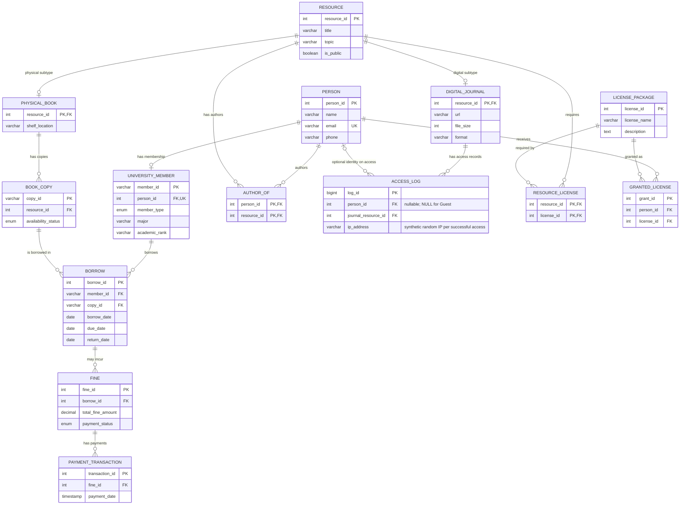

# ERD — Library Management System (Updated)

## Structural rules

- `UNIVERSITY_MEMBER.member_id` is the independent member key. `BORROW.member_id` references it; it is not a `person_id`.
- Every University Member has exactly one `person_id`; `person_id` is unique in `UNIVERSITY_MEMBER` and is used to test `AUTHOR_OF`.
- `STUDENT` requires `major`; `FACULTY` requires `academic_rank`. The other attribute may also be populated.
- Any `PERSON` can be an author through `AUTHOR_OF`. There is no `EXTERNAL_AUTHOR` table or `PERSON.person_type` discriminator.
- Resource kind is represented by the subtype table (`PHYSICAL_BOOK` or `DIGITAL_JOURNAL`), not a `RESOURCE.resource_type` column.
- Multiple `FINE` rows may exist for one `BORROW`: a new late penalty is added to an unpaid fine; if prior fines are settled, a new fine row preserves the settlement history.
- `ACCESS_LOG.person_id` is nullable and references `PERSON.person_id`; it is populated when a valid ID was supplied and NULL for anonymous Guest. `journal_resource_id` is mandatory and references `DIGITAL_JOURNAL.resource_id`. `ip_address` is generated randomly by `sp_access_digital_journal` for each successful Access; it is synthetic and is not the client real IP. Only successful accesses are logged; access time and allow/deny status are not stored.
- `RESOURCE.is_public` remains on the parent `RESOURCE` entity and is used by the Guest branch; there is no duplicated `is_public` column in `DIGITAL_JOURNAL`.
