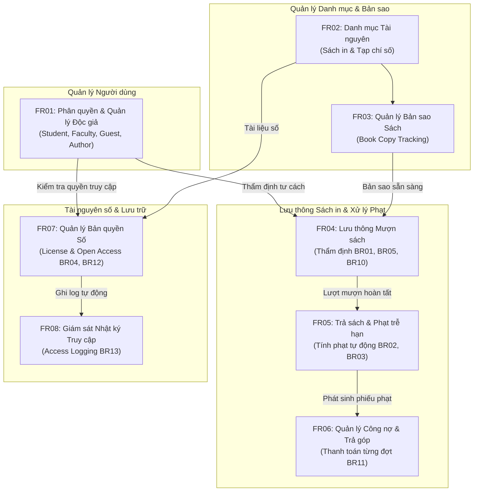
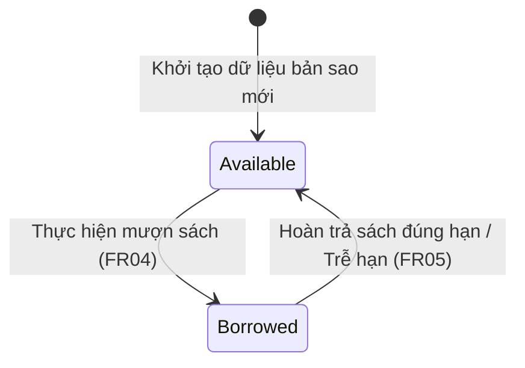
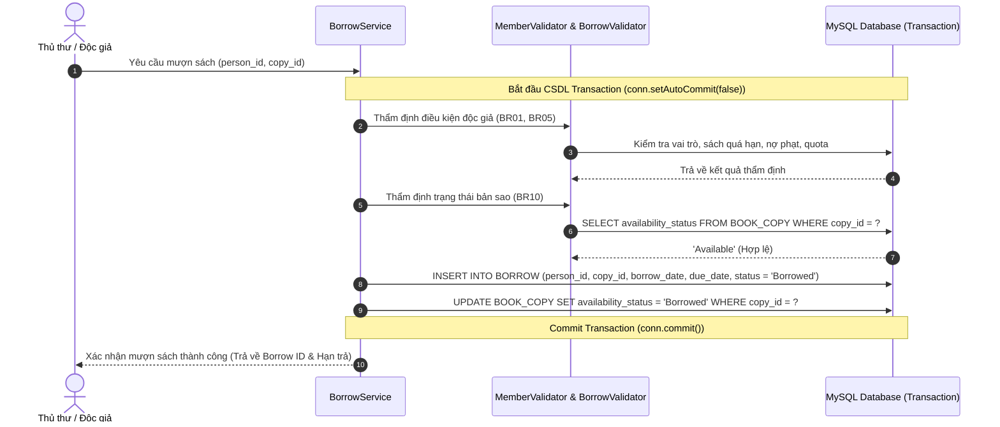
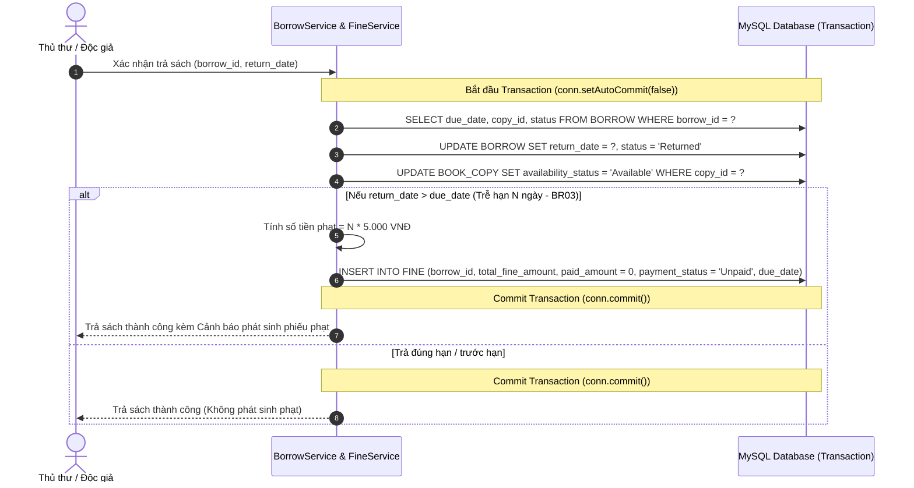
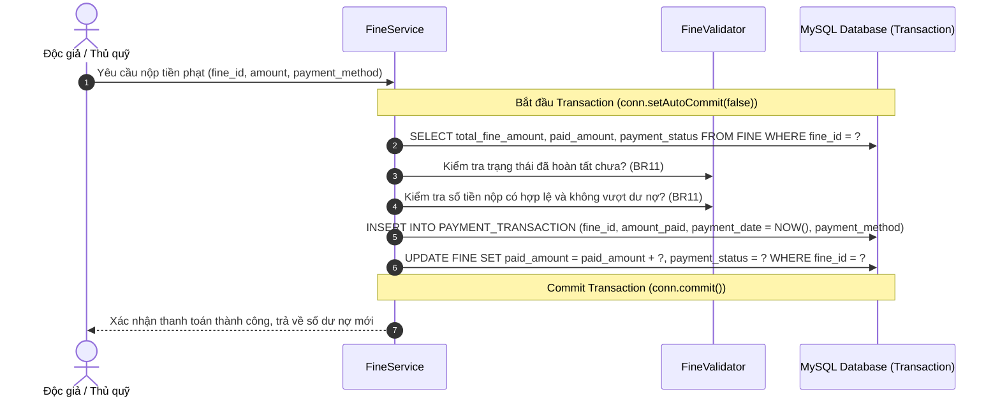
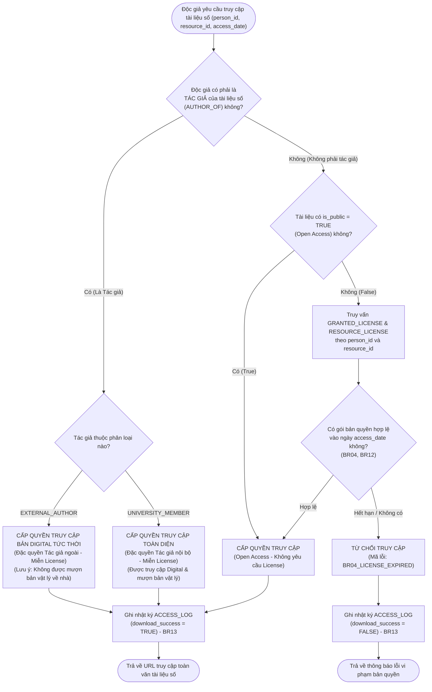

# ĐẶC TẢ CHI TIẾT LUỒNG HOẠT ĐỘNG CÁC CHỨC NĂNG NGHIỆP VỤ (FR01 - FR08)
**Dự án:** Hệ thống Quản lý Thư viện số & Lưu trữ mở (*Digital Library Management System & Open Repository*)  
**Tài liệu đối chiếu:** `Source/G5_phase1.pdf` / `Source/G5_phase1.txt` (SRS Phase 1)  
**Mã nguồn đối chiếu:** `Project/src/com/library/` & CSDL `library_db`

---

## 1. Khái quát Hệ thống & Triết lý Thiết kế Luồng Nghiệp vụ

Hệ thống Quản lý Thư viện số và Lưu trữ mở được thiết kế nhằm đồng bộ hóa quy trình quản lý giữa **tài nguyên vật lý** (sách in truyền thống, quản lý theo từng bản sao/mã vạch) và **tài nguyên số** (tạp chí, bài báo khoa học có gắn mã DOI và quản lý gói bản quyền).

Theo tài liệu đặc tả **SRS Phase 1 (G5_phase1)**, hệ thống không đặt trọng tâm vào các chức năng nhập liệu danh mục tĩnh đơn thuần (CRUD cơ bản) vì các dữ liệu danh mục ban đầu (Master Data: danh sách sách, thành viên, bản sao, gói bản quyền) được khởi tạo và kiểm soát cấu trúc trực tiếp qua kịch bản cơ sở dữ liệu (`schema.sql`, `sample_data.sql`) và mã nguồn khởi tạo (`DatabaseInitializer.java`). Trọng tâm cốt lõi của hệ thống là **các luồng giao dịch nghiệp vụ thực thi (Operational & Transactional Flows)** bảo đảm toàn vẹn dữ liệu và kiểm soát nghiêm ngặt 13 Quy chế Nghiệp vụ (**BR01 đến BR13**).

---

## 2. Chi tiết Luồng Hoạt động Của Từng Chức năng (FR01 đến FR08)



---

### FR01: User Management (Quản lý Người Dùng & Phân Quyền Độc Giả)

#### 1. Mục tiêu & Thực thể liên quan
- **Mục tiêu**: Quản lý thông tin định danh cá nhân, phân cấp quyền hạn theo từng nhóm đối tượng độc giả, và phân định rõ ràng giữa độc giả mượn sách và tư cách tác giả xuất bản.
- **Thực thể CSDL**:
  - `PERSON` (Superclass: Khóa chính `person_id`, CCCD `ssn`, `name`, `email`, `phone`, `person_type`).
  - `UNIVERSITY_MEMBER` (Subclass: Khóa chính & ngoại `person_id`, `member_id`, `department`, `member_type`: `STUDENT` hoặc `FACULTY`, `major`, `academic_rank`).
  - `EXTERNAL_AUTHOR` (Subclass: Khóa chính & ngoại `person_id`, `affiliation`, `biography`).
  - `AUTHOR_OF` (Associative table: `person_id`, `resource_id` - Liên kết tác giả và tác phẩm).

#### 2. Quy chế Nghiệp vụ chi phối & Điều chỉnh
- **BR01 (Eligible Borrowers - Độc giả Mượn Sách Vật Lý)**:
  - Chỉ thành viên chính thức của trường đại học (`STUDENT`, `FACULTY` trực thuộc `UNIVERSITY_MEMBER`) mới được phép tạo giao dịch mượn sách vật lý về nhà.
  - Khách vãng lai (`GUEST`) và tác giả ngoài (`EXTERNAL_AUTHOR`) **tuyệt đối không được phép mượn sách in về nhà**; các đối tượng này chỉ được đọc tại chỗ trong khuôn viên thư viện hoặc tra cứu tài liệu mở.
- **Quy tắc Nghiệp vụ Xuất bản Tài nguyên (Resource Publishing Roles)**:
  - **Khách ngoài (`GUEST`)**: Khi một đối tượng bên ngoài đóng góp hoặc xuất bản tài nguyên vào thư viện/kho lưu trữ mở, họ xuất bản với tư cách là **`EXTERNAL_AUTHOR`**. Hệ thống ghi nhận thêm thông tin cơ quan công tác (`affiliation`) và tiểu sử học thuật (`biography`).
  - **Thành viên trường (`UNIVERSITY_MEMBER`)**: Sinh viên hoặc Giảng viên của trường được tùy ý xuất bản tài nguyên tri thức (giáo trình, nghiên cứu, đồ án, luận văn) với tư cách là **`UNIVERSITY_MEMBER`**, gắn liền với mã thành viên (`member_id`), đơn vị (`department`), và chuyên ngành (`major`) hoặc học hàm (`academic_rank`).
- **BR05 (Borrow Eligibility & Quota)**: Độc giả chỉ được phép mượn sách khi đáp ứng đồng thời 3 điều kiện:
  1. Không có sách mượn nào đang trong tình trạng trễ hạn.
  2. Không có phiếu phạt nào quá hạn chưa thanh toán.
  3. Tổng số lượng sách đang mượn hiện tại chưa chạm ngưỡng tối đa (Sinh viên tối đa 3 cuốn/14 ngày, Giảng viên tối đa 10 cuốn/30 ngày).
- **BR09 (Authorship Attribution)**: Mọi tài nguyên trong thư viện phải liên kết với ít nhất một tác giả thông qua quan hệ `AUTHOR_OF`.

#### 3. Luồng Hoạt động (Operational Flow)
1. Hệ thống tiếp nhận yêu cầu tra cứu hoặc thẩm định độc giả qua `person_id`.
2. Truy vấn kết hợp `PERSON` LEFT JOIN `UNIVERSITY_MEMBER`.
3. Kiểm tra vai trò: Nếu không phải `STUDENT` hoặc `FACULTY`, xác định vi phạm `BR01` (Ineligible Member).
4. Kiểm tra lịch sử mượn trong bảng `BORROW`: Đếm số sách đang mượn (`status = 'Borrowed'`), kiểm tra có lượt mượn nào có `due_date < CURRENT_DATE` hay không (Vi phạm quá hạn `BR05`).
5. Kiểm tra bảng `FINE`: Kiểm tra có phiếu phạt nào có `payment_status != 'Completed'` và `due_date < CURRENT_DATE` hay không (Vi phạm nợ phạt `BR05`).
6. Trả về trạng thái hợp lệ hoặc ném ngoại lệ tương ứng (`IneligibleMemberException`, `OverdueBooksPendingException`, `OutstandingFineException`, `BorrowQuotaExceededException`).

---

### FR02: Resource Management (Quản lý Danh Mục Tài Nguyên Thư Viện)

#### 1. Mục tiêu & Thực thể liên quan
- **Mục tiêu**: Quản lý danh mục tài nguyên tri thức gồm hai phân nhánh riêng biệt: Sách in vật lý và Tạp chí/Bài báo số.
- **Thực thể CSDL**:
  - `RESOURCE` (Superclass: `resource_id`, `title`, `publish_date`, `topic`, `resource_type`: `'PHYSICAL_BOOK'` hoặc `'DIGITAL_JOURNAL'`).
  - `PHYSICAL_BOOK` (Subclass: `resource_id`, `shelf_location` - Thuộc tính `isbn` đã được loại bỏ để tinh giản).
  - `DIGITAL_JOURNAL` (Subclass: `resource_id`, `doi`, `url`, `file_size`, `format`, `is_public`).
  - `AUTHOR_OF` & `PERSON`: Liên kết tác giả sáng tác tài nguyên.

#### 2. Quy chế Nghiệp vụ chi phối
- Tài nguyên sách vật lý được theo dõi tồn kho và lưu thông thông qua các bản sao cá thể (`BOOK_COPY`).
- Tài nguyên số không có bản sao vật lý mà được quản lý bằng liên kết định danh toàn cầu DOI và liên kết cấp phép bản quyền (`RESOURCE_LICENSE`).
- Hỗ trợ cờ `is_public` (Open Access) cho phép tài liệu mở được đọc công khai mà không bị ràng buộc gói bản quyền thương mại.

#### 3. Luồng Hoạt động (Operational Flow)
1. Tiếp nhận từ khóa tìm kiếm (theo tên sách, chủ đề, hoặc mã DOI) và bộ lọc phân loại (`ALL`, `PHYSICAL_BOOK`, `DIGITAL_JOURNAL`).
2. Thực thi truy vấn kết hợp:
   - `RESOURCE` LEFT JOIN `PHYSICAL_BOOK` LEFT JOIN `DIGITAL_JOURNAL`.
   - Kết hợp bảng `BOOK_COPY` (gom nhóm theo `resource_id`) để tính toán tức thời: Tổng số bản sao (`COUNT(copy_id)`) và số bản sao khả dụng (`COUNT(CASE WHEN availability_status = 'Available' THEN 1 END)`).
3. Đóng gói dữ liệu hiển thị kèm nhãn phân định (Sách in, Tạp chí số cần License, Tạp chí số Open Access).

---

### FR03: Copy Tracking (Quản lý Bản Sao Sách Vật Lý)

#### 1. Mục tiêu & Thực thể liên quan
- **Mục tiêu**: Định danh và theo dõi trạng thái lưu thông của từng bản sao sách cụ thể trên kệ sách thư viện (có thể mượn được hay đang mượn).
- **Thực thể CSDL**:
  - `BOOK_COPY` (`copy_id` VARCHAR, `resource_id`, `availability_status`: `'Available'` hoặc `'Borrowed'`).

#### 2. Quy chế Nghiệp vụ chi phối
- **BR10 (Copy Availability Validation)**: Chỉ những bản sao có trạng thái `availability_status = 'Available'` mới được đưa vào danh sách cho phép bạn đọc mượn. Bản sao đang ở trạng thái `'Borrowed'` bị hệ thống khóa tự động.
- **Loại bỏ `condition_status` và `'Under Maintenance'`**: Hệ thống quản lý trạng thái bản sao tinh gọn chỉ gồm 2 trạng thái: Có thể mượn (`Available`) hoặc Đang được mượn (`Borrowed`).
- **Quy tắc đánh mã `copy_id` và loại bỏ `barcode`**: Mỗi bản sao được định danh duy nhất bằng một mã `copy_id` theo cú pháp ngữ nghĩa `<resource_id>_<index>` kiểu `VARCHAR` (ví dụ: `'1_1'`, `'1_2'`, `'2_1'`). Mã này thay thế hoàn toàn và loại bỏ thuộc tính `barcode`.

#### 3. Biểu đồ Chuyển Trạng Thái Bản Sao Sách


---

### FR04: Borrow Execution (Quản lý Lưu Thông Mượn Sách)

#### 1. Mục tiêu & Thực thể liên quan
- **Mục tiêu**: Tiếp nhận yêu cầu mượn sách, thẩm định điều kiện độc giả và tình trạng sách, thiết lập kỳ hạn trả và khóa bản sao trong CSDL.
- **Thực thể CSDL**:
  - `BORROW` (`borrow_id`, `person_id`, `copy_id`, `borrow_date`, `due_date`, `return_date`, `status`).
  - `BOOK_COPY`, `PERSON`.

#### 2. Quy chế Nghiệp vụ chi phối
- **BR01**: Chặn nếu độc giả là `GUEST` hoặc `EXTERNAL_AUTHOR`.
- **BR05**: Chặn nếu độc giả đang có sách quá hạn, đang nợ phiếu phạt quá hạn, hoặc số sách đang giữ đạt hạn mức (Quota $\ge 3$ cuốn).
- **BR10**: Chặn nếu bản sao sách không ở trạng thái `'Available'`.
- **BR02 (Standard Borrow Duration)**: Hạn trả tiêu chuẩn (`due_date`) được tính tự động bằng ngày mượn cộng thêm 14 ngày (`due_date = borrow_date + 14 days`).

#### 3. Luồng Giao Dịch ACID (Connection chung)


---

### FR05: Fine Management & Trả Sách (Xử Lý Trả Sách & Phát Sinh Phiếu Phạt)

#### 1. Mục tiêu & Thực thể liên quan
- **Mục tiêu**: Ghi nhận thời điểm hoàn trả sách thực tế, giải phóng bản sao sách về trạng thái sẵn sàng, và tự động phát sinh phiếu phạt nếu vi phạm trễ hạn.
- **Thực thể CSDL**:
  - `BORROW` (cập nhật `return_date`, `status = 'Returned'`).
  - `BOOK_COPY` (cập nhật `availability_status = 'Available'`).
  - `FINE` (`fine_id`, `borrow_id`, `total_fine_amount`, `paid_amount`, `payment_status`, `due_date`).

#### 2. Quy chế Nghiệp vụ chi phối
- **BR02**: Đánh dấu ngày trả sách thực tế `return_date`.
- **BR03 (Late Return Penalty Calculation)**:
  - Nếu `return_date > due_date`: Hệ thống xác định độc giả trả trễ $N$ ngày ($N = \text{return\_date} - \text{due\_date}$).
  - Số tiền phạt trễ hạn được tính tự động theo công thức:
    $$\text{total\_fine\_amount} = N \times 5.000\text{ VNĐ}$$
  - Tự động tạo bản ghi mới trong bảng `FINE` với `total_fine_amount`, `paid_amount = 0`, `payment_status = 'Unpaid'`, và hạn tất toán tiền phạt `due_date = return_date + 14 days`.
- **BR10**: Khôi phục trạng thái bản sao sách về `'Available'` để người khác có thể mượn tiếp.

#### 3. Luồng Giao Dịch ACID Hoàn Trả & Phạt


---

### FR06: Payment Transaction (Quản lý Công Nợ & Thu Tiền Phạt Trả Góp)

#### 1. Mục tiêu & Thực thể liên quan
- **Mục tiêu**: Thu tiền phạt trễ hạn, hỗ trợ thanh toán linh hoạt từng đợt (trả góp), đối soát số dư nợ còn lại và cập nhật trạng thái phiếu phạt.
- **Thực thể CSDL**:
  - `FINE` (`fine_id`, `total_fine_amount`, `paid_amount`, `payment_status`).
  - `PAYMENT_TRANSACTION` (`transaction_id`, `fine_id`, `amount_paid`, `payment_date`, `payment_method`: `'Cash'`, `'Bank Transfer'`, `'Credit Card'`).

#### 2. Quy chế Nghiệp vụ chi phối
- **BR11 (Installment Fine Settlement)**:
  - Cho phép người dùng thanh toán tiền phạt làm nhiều đợt.
  - Số tiền thanh toán mỗi lần $\text{amount} > 0$ và không được vượt quá số dư nợ còn lại:
    $$\text{remaining\_balance} = \text{total\_fine\_amount} - \text{paid\_amount}$$
  - Mỗi lần thanh toán tạo một bản ghi `PAYMENT_TRANSACTION`.
  - Cập nhật lũy kế `paid_amount = paid_amount + amount` trong bảng `FINE`.
  - Nếu `paid_amount == total_fine_amount`: Chuyển `payment_status = 'Completed'`.
  - Nếu `paid_amount < total_fine_amount`: Chuyển `payment_status = 'Partially Paid'`.
  - Nghiêm cấm thanh toán đối với phiếu phạt đã ở trạng thái `'Completed'` (Ném `FineAlreadySettledException`).

#### 3. Luồng Giao Dịch ACID Thanh Toán Trả Góp


---

### FR07: Digital License Management (Quản lý Bản Quyền & Thẩm Định Quyền Đọc Số)

#### 1. Mục tiêu & Thực thể liên quan
- **Mục tiêu**: Kiểm soát quyền truy cập trực tuyến đối với các tài liệu số, bảo đảm quyền sở hữu trí tuệ của nhà xuất bản, đồng thời bảo vệ đặc quyền tự do truy cập tác phẩm của chính các tác giả sáng tác.
- **Thực thể CSDL**:
  - `DIGITAL_JOURNAL` (`resource_id`, `doi`, `url`, `file_size`, `format`, `is_public`).
  - `AUTHOR_OF` (`person_id`, `resource_id`: Quan hệ định danh tác giả tác phẩm).
  - `EXTERNAL_AUTHOR` & `UNIVERSITY_MEMBER`: Phân định tư cách tác giả.
  - `LICENSE_PACKAGE` (`license_id`, `license_name`, `provider`, `description`).
  - `RESOURCE_LICENSE` (`resource_id`, `license_id`).
  - `GRANTED_LICENSE` (`grant_id`, `person_id`, `license_id`, `valid_from`, `valid_to`).

#### 2. Quy chế Nghiệp vụ chi phối & Điều chỉnh
- **Quy tắc Đặc quyền Tác giả (Author Access Privilege)**:
  - Tác giả được **truy cập tùy ý vào chính tác phẩm của họ** mà không cần sở hữu bất kỳ gói bản quyền thương mại (`GRANTED_LICENSE`) nào.
  - **Ràng buộc đối với `EXTERNAL_AUTHOR`**: Riêng đối tượng là Tác giả ngoài (`EXTERNAL_AUTHOR`) chỉ được cấp quyền truy cập tùy ý vào **bản Digital** của tác phẩm. Họ không được phép mượn bản sao vật lý (`BOOK_COPY`) về nhà theo quy chế lưu thông vật lý (BR01).
  - Đối với Tác giả là Thành viên trường (`UNIVERSITY_MEMBER`): Được truy cập tùy ý bản Digital và được mượn bản sao vật lý về nhà theo quota độc giả của trường.
- **Open Access (Tài liệu công khai)**: Nếu bài báo số có cờ `is_public = TRUE`, mọi đối tượng bạn đọc (kể cả khách ngoài `GUEST`) đều được phép đọc toàn văn mà không cần bất kỳ gói bản quyền nào.
- **BR04 & BR12 (Active License Enforcement)**: Đối với bài báo số có bản quyền thương mại (`is_public = FALSE`) và người đọc không phải là tác giả của bài báo đó, người dùng bắt buộc phải sở hữu gói bản quyền (`GRANTED_LICENSE`) thỏa mãn:
  $$\text{valid\_from} \le \text{access\_date} \le \text{valid\_to}$$
  đồng thời gói bản quyền đó phải chứa tài nguyên cần đọc (`RESOURCE_LICENSE`). Nếu không thỏa mãn, hệ thống từ chối truy cập và ném ngoại lệ `LicenseExpiredException`.

#### 3. Biểu đồ Luồng Thẩm Định Bản Quyền Số (Cập nhật Đặc quyền Tác giả)


---

### FR08: Access Logging (Giám Sát & Nhật Ký Truy Cập Tài Liệu Số)

#### 1. Mục tiêu & Thực thể liên quan
- **Mục tiêu**: Lưu vết toàn bộ lịch sử tương tác với tài nguyên số để phục vụ thống kê lượt đọc, kiểm toán an ninh và phát hiện các hành vi quét dữ liệu trái phép.
- **Thực thể CSDL**:
  - `ACCESS_LOG` (`log_id`, `access_timestamp`, `ip_address`, `download_success`, `person_id`, `journal_resource_id`).

#### 2. Quy chế Nghiệp vụ chi phối
- **BR13 (High-throughput Audit Logging)**:
  - Bảng `ACCESS_LOG` phải ghi nhận mọi lượt yêu cầu truy cập, **bất kể yêu cầu đó được cấp quyền thành công hay bị từ chối**.
  - **Tối ưu hóa kiến trúc CSDL**: Bảng `ACCESS_LOG` được thiết kế **không sử dụng khóa ngoại cứng (`FOREIGN KEY`)** liên kết sang bảng `PERSON` và `RESOURCE`. Điều này loại bỏ hoàn toàn chi phí khóa bảng (Lock contention) và kiểm tra toàn vẹn tham chiếu chéo, bảo đảm tốc độ ghi dữ liệu cực nhanh (High Write Throughput) đáp ứng tải cao khi có hàng nghìn bạn đọc truy cập đồng thời.

#### 3. Luồng Hoạt động (Operational Flow)
1. Khi có bất kỳ request thẩm định tài liệu số nào được gửi đến từ `FR07`:
2. Hệ thống trích xuất thông tin: `person_id`, `journal_resource_id`, địa chỉ IP người dùng (`ip_address`), thời gian hiện tại (`access_timestamp`), và kết quả thẩm định (`download_success`: `1` nếu thành công, `0` nếu bị chặn).
3. Thực thi câu lệnh `INSERT INTO ACCESS_LOG` độc lập với luồng đọc file.
4. Giao diện quản trị cho phép tra cứu bảng nhật ký thời gian thực kết hợp JOIN mềm hiển thị tên độc giả và tiêu đề tài nguyên.

---

## 3. Bảng Tổng Hợp Ánh Xạ Quy Chế Nghiệp Vụ (BR01 - BR13) Với Các FR

| Quy chế (BR) | Tên quy định nghiệp vụ | Mã chức năng chi phối | Tầng mã nguồn hiện thực |
| :--- | :--- | :--- | :--- |
| **BR01** | Eligible Borrowers (Chỉ thành viên nội bộ được mượn sách) | **FR01, FR04** | `MemberValidator`, `MemberService` |
| **BR02** | Standard Borrow Duration (Hạn mượn chuẩn 14 ngày & Hoàn tất trả) | **FR04, FR05** | `BorrowValidator`, `BorrowService` |
| **BR03** | Late Return Penalty (Phạt trễ hạn 5.000 VNĐ / ngày) | **FR05** | `BorrowService`, `FineRepository` |
| **BR04** | Licensed Resource Access (Truy cập tạp chí số phải có bản quyền) | **FR07** | `LicenseValidator`, `DigitalJournalService` |
| **BR05** | Borrow Eligibility & Quota (Chặn khi quá hạn, nợ phạt, quá quota) | **FR01, FR04** | `MemberValidator`, `MemberService` |
| **BR06** | Copy Lifecycle Status (Bãi bỏ condition_status, chỉ dùng Available/Borrowed) | **FR03** | Mô hình `BOOK_COPY.availability_status` |
| **BR07** | Resource Types (Phân biệt sách in và tạp chí số) | **FR02** | `ResourceRepository`, `PHYSICAL_BOOK`, `DIGITAL_JOURNAL` |
| **BR08** | Unique Transaction Code (Định danh giao dịch thanh toán) | **FR06** | `PAYMENT_TRANSACTION.transaction_id` |
| **BR09** | Authorship Attribution (Tài nguyên phải có tác giả) | **FR01, FR02, FR07** | `AUTHOR_OF` quan hệ liên kết CSDL |
| **BR10** | Copy Availability (Bản sao phải Available mới được mượn) | **FR03, FR04** | `BorrowValidator`, `BorrowRepository` |
| **BR11** | Installment Fine Settlement (Cho phép trả góp tiền phạt) | **FR06** | `FineValidator`, `FineService` |
| **BR12** | Active License Package (Gói bản quyền phải còn trong thời hạn) | **FR07** | `LicenseValidator`, `GrantedLicenseRepository` |
| **BR13** | High-throughput Audit Logging (Ghi log không dùng khóa ngoại) | **FR08** | `AccessLogRepository`, `ACCESS_LOG` schema |

---

## 4. Đề Xuất Giải Pháp Định Danh Tác Giả & Phân Biệt Đối Tượng Đơn Giản, Dễ Hiểu Nhất

### 4.1. Phân tích Bản chất & Ý nghĩa của Việc Đặt Khóa trong CSDL

Việc đặt khóa (Primary Key - PK, Foreign Key - FK, và Composite Key) trong cơ sở dữ liệu không chỉ đơn thuần là kỹ thuật indexing, mà là **công cụ mô hình hóa ngữ nghĩa thực tế và bảo đảm toàn vẹn thực thể**:

1. **Khóa chính đơn vị (Primary Key - PK trong Superclass `PERSON`)**:
   - `PERSON.person_id`: Đại diện cho một con người thực thể duy nhất trong thế giới thực. Bất kể người này là ai (Sinh viên, Giảng viên, Khách hay Tác giả), họ chỉ có duy nhất một bản ghi định danh nhân thân (họ tên, CCCD/`ssn`, email, số điện thoại).
2. **Khóa chính đồng thời là Khóa ngoại (Subclass PK/FK trong Kế thừa Table-per-Subclass)**:
   - `UNIVERSITY_MEMBER.person_id` vừa là PK vừa là FK tham chiếu `PERSON(person_id)`. Nó biểu thị mối quan hệ kế thừa 1:1 hoặc 1:0..1. Sự hiện diện của một dòng trong bảng này khẳng định: *"Người này là Thành viên chính thức của trường"*.
   - `EXTERNAL_AUTHOR.person_id` vừa là PK vừa là FK tham chiếu `PERSON(person_id)`. Sự hiện diện của một dòng trong bảng này khẳng định: *"Người này là Tác giả độc lập từ bên ngoài"*.
3. **Khóa chính phức hợp (Composite Primary Key trong Associative Entity `AUTHOR_OF`)**:
   - `AUTHOR_OF(person_id, resource_id)`: Cặp đôi `(person_id, resource_id)` làm khóa chính.
   - **Ý nghĩa ngữ nghĩa**: Tác giả là một **vai trò quan hệ (Relational Role)**, không phải một bản thể tĩnh. Một người trở thành "Tác giả" khi và chỉ khi họ sáng tác ít nhất một tác phẩm. Khóa phức hợp đảm bảo tính duy nhất: Một tác giả có thể viết nhiều tác phẩm, một tác phẩm có thể có nhiều đồng tác giả, nhưng không thể gán trùng lặp cùng một tác giả 2 lần cho cùng một tác phẩm.

---

### 4.2. Giải Pháp Định Danh 2 Bước Đơn Giản Nhất

Để trả lời hai câu hỏi nghiệp vụ:
1. *Người này có phải là Tác giả hay không?*
2. *Nếu là Tác giả, thì là Thành viên trường (`UNIVERSITY_MEMBER`) hay Tác giả ngoài (`EXTERNAL_AUTHOR`)?*

Hệ thống áp dụng cơ chế định danh cực kỳ trực quan và chuẩn hóa 3NF như sau:

#### Bước 1: Kiểm tra "Có phải Tác giả hay không?"
Kiểm tra xem `person_id` có tồn tại trong bảng quan hệ `AUTHOR_OF` hay không:
- **Kiểm tra tác giả của một tài nguyên cụ thể**:
  ```sql
  SELECT EXISTS(SELECT 1 FROM AUTHOR_OF WHERE person_id = :personId AND resource_id = :resourceId) AS is_author_of_work;
  ```
- **Kiểm tra tác giả nói chung trong toàn hệ thống**:
  ```sql
  SELECT EXISTS(SELECT 1 FROM AUTHOR_OF WHERE person_id = :personId) AS is_any_author;
  ```

#### Bước 2: Phân loại "Tác giả là UNIVERSITY_MEMBER hay EXTERNAL_AUTHOR?"
Dựa trực tiếp vào sự hiện diện của `person_id` tại hai bảng con kế thừa:
- Nếu `person_id` tồn tại trong `UNIVERSITY_MEMBER` $\rightarrow$ Tác giả là **Thành viên trường** (Sinh viên hoặc Giảng viên, được mượn sách về nhà và truy cập Digital tự do).
- Nếu `person_id` tồn tại trong `EXTERNAL_AUTHOR` $\rightarrow$ Tác giả là **Tác giả ngoài** (Đến từ cơ quan bên ngoài, chỉ được truy cập Digital tự do, không được mượn bản vật lý về nhà).

#### View SQL Định Danh Tác Giả Trực Quan (`VIEW_AUTHOR_IDENTIFIER`)
Nhằm giúp cho lập trình viên ứng dụng và các báo cáo nghiệp vụ không cần phải viết lại các câu lệnh JOIN phức tạp, hệ thống cung cấp sẵn một SQL View chuẩn hóa:

```sql
CREATE OR REPLACE VIEW VIEW_AUTHOR_IDENTIFIER AS
SELECT 
    p.person_id,
    p.ssn,
    p.name,
    p.email,
    p.person_type AS registered_person_type,
    -- Phân loại tư cách tác giả cực kỳ tường minh
    CASE 
        WHEN um.person_id IS NOT NULL THEN 'UNIVERSITY_MEMBER'
        WHEN ea.person_id IS NOT NULL THEN 'EXTERNAL_AUTHOR'
        ELSE 'GUEST_OR_OTHER'
    END AS author_affiliation_type,
    um.member_type AS internal_role, -- STUDENT hoặc FACULTY nếu là người trong trường
    um.department,                    -- Khoa/Viện trực thuộc
    ea.affiliation AS external_affiliation, -- Tổ chức bên ngoài (nếu là tác giả ngoài)
    COUNT(DISTINCT ao.resource_id) AS total_published_resources
FROM PERSON p
INNER JOIN AUTHOR_OF ao ON p.person_id = ao.person_id
LEFT JOIN UNIVERSITY_MEMBER um ON p.person_id = um.person_id
LEFT JOIN EXTERNAL_AUTHOR ea ON p.person_id = ea.person_id
GROUP BY p.person_id, p.ssn, p.name, p.email, p.person_type, 
         um.person_id, um.member_type, um.department, ea.person_id, ea.affiliation;
```

---

## 5. Đánh Giá Chuyên Sâu Các Đề Xuất Tinh Gọn CSDL (Architecture Evaluation)

Dưới đây là đánh giá kỹ thuật chuyên sâu về các định hướng tinh chỉnh CSDL được nêu trong ghi chú phát triển:

### 5.1. Bỏ 'Under Maintenance' & Bỏ `condition_status`: Chỉ dùng `availability_status`
- **Đánh giá**: **RẤT HỢP LÝ & NÊN ÁP DỤNG**.
- **Lý do**:
  - Trong luồng lưu thông mượn trả sách (`FR04, FR05`), thư viện chỉ cần biết đúng một thông tin duy nhất: Cuốn sách này **có thể cho mượn được hay không**.
  - Việc duy trì đồng thời `condition_status` (Good, Torn Cover, Missing Pages...) và `availability_status` (Available, Borrowed, Under Maintenance) dẫn đến sự chồng chéo trạng thái (ví dụ: Sách có `condition_status = 'Torn Cover'` nhưng `availability_status = 'Available'` thì có cho mượn hay không?).
  - Khi tinh gọn, `BOOK_COPY` chỉ cần duy nhất thuộc tính `availability_status ENUM('Available', 'Borrowed')` (hoặc cờ `is_available BOOLEAN`). Trạng thái máy (State Machine) chuyển đổi trực tiếp giữa 2 trạng thái rõ ràng, loại bỏ toàn bộ các ngoại lệ bảo trì phức tạp không cần thiết.

### 5.2. Bỏ ISBN của `PHYSICAL_BOOK`; `copy_id` đánh theo `<resource_id>_<index>` chuyển thành VARCHAR
- **Đánh giá**: **HOÀN TOÀN HỢP LÝ & ĐẠT CHUẨN THIẾT KẾ CSDL TỐI ƯU**.
- **Lý do**:
  - Trong phạm vi hệ thống thư viện nội bộ, mỗi đầu sách đã có khóa chính duy nhất là `resource_id` (INTEGER) thuộc bảng cha `RESOURCE`.
  - Việc loại bỏ thuộc tính `isbn` khỏi `PHYSICAL_BOOK` giúp đơn giản hóa luồng nhập liệu, loại bỏ ràng buộc định dạng chuẩn ISBN quốc tế (10 hoặc 13 chữ số) không bắt buộc đối với giáo trình nội bộ hoặc tài liệu tự biên soạn của nhà trường.
  - Chuyển `copy_id` thành kiểu `VARCHAR(30)` và đánh theo quy tắc `<resource_id>_<index>` (ví dụ: Sách ID 1 có các bản sao `'1_1'`, `'1_2'`; Sách ID 7 có bản sao `'7_1'`):
    - Đây là mô hình **Composite Meaning Identifier** phản ánh bản chất của Thực thể yếu (Weak Entity).
    - Giúp người quản lý, thủ thư và độc giả nhìn vào mã bản sao là nhận diện ngay lập tức cuốn sách thuộc đầu sách nào và số thứ tự bản sao mà không cần thực hiện thêm câu lệnh JOIN tra cứu.

### 5.3. Đánh giá chuyên sâu chức năng của `barcode` và quyết định loại bỏ
- **Bản chất của Barcode trong hệ thống thư viện**:
  - Barcode (mã vạch 1D như Code 128 hay 2D như QR Code) trong thực tế chỉ là **phương tiện mã hóa quang học của một chuỗi ký tự định danh** dán lên gáy sách để súng quét mã laser đọc nhanh và điền vào ô tìm kiếm trên phần mềm thay vì thủ thư phải gõ tay.
  - Barcode **không hề mang giá trị nghiệp vụ hay ngữ nghĩa dữ liệu độc lập** tách rời khỏi mã định danh bản sao.
- **Đánh giá khả năng thay thế hoàn toàn của `copy_id` đối với `barcode`**:
  1. Khi `copy_id` đã được chuyển sang kiểu chuỗi (`VARCHAR`) có quy tắc ngữ nghĩa `<resource_id>_<index>` (ví dụ `'1_1'`, `'1_2'`), chuỗi này **duy nhất tuyệt đối trên toàn hệ thống** (đóng vai trò Khóa chính Primary Key của bảng `BOOK_COPY`).
  2. Bất kỳ súng quét mã vạch nào (Barcode Scanner) hoặc thiết bị di động đọc QR Code đều có thể quét trực tiếp chuỗi ký tự `'1_1'` hay `'1_2'` được in từ `copy_id`.
  3. Việc duy trì thêm một cột riêng biệt `barcode VARCHAR(50) UNIQUE` trong CSDL tạo ra sự dư thừa dữ liệu (redundancy) 100%, tốn kém thêm một chỉ mục UNIQUE B-Tree, và tạo thêm gánh nặng nhập liệu kép cho thủ thư.
- **Quyết định kiến trúc**: **LOẠI BỎ HOÀN TOÀN THUỘC TÍNH `barcode`** khỏi bảng `BOOK_COPY`. Thuộc tính `copy_id` kiểu `VARCHAR(30)` đảm nhiệm trọn vẹn cả 3 chức năng: Khóa chính CSDL, Định danh ngữ nghĩa bản sao, và Mã quét quang học.

### 5.4. Đánh giá chức năng của thuộc tính `doi` trong `DIGITAL_JOURNAL`
- **Đánh giá**:
  - DOI (Digital Object Identifier) là tiêu chuẩn định danh quốc tế dành cho các bài báo khoa học xuất bản trên các nhà xuất bản lớn (IEEE, ACM, Springer).
  - Đối với hệ thống Thư viện số & Lưu trữ mở nội bộ trường, nếu người dùng chỉ truy cập trực tiếp bài báo thông qua đường dẫn tệp (`url`) và định danh tài nguyên nội bộ (`resource_id`), thì thuộc tính `doi` **không đóng vai trò quyết định trong việc khóa/mở quyền truy cập**. Việc bỏ `doi` (hoặc cho phép NULL) giúp hệ thống đơn giản hơn và dễ dàng tiếp nhận các tài liệu số nội bộ (đồ án, luận văn sinh viên) vốn không có mã DOI quốc tế.

### 5.5. Bỏ chức năng download; bỏ thuộc tính `download_success` ở `ACCESS_LOG`
- **Đánh giá**:
  - Khi hệ thống chuyển sang mô hình "Đọc trực tuyến" (Online Reader / In-browser Viewer) để bảo vệ bản quyền, hành vi tương tác là "Truy cập / Xem" chứ không phải "Tải file về máy".
  - Thuộc tính `download_success` trong `ACCESS_LOG` nên được đổi tên thành **`access_granted` (BOOLEAN)**. Thuộc tính này phản ánh trung thực bản chất kiểm toán: Yêu cầu mở tài liệu của người dùng có được chấp thuận hay bị từ chối do vi phạm bản quyền.

### 5.6. Bỏ theo dõi `person_id` trong `ACCESS_LOG`, chỉ ghi nhận `ip_address`
- **Đánh giá**:
  - Đối với các tài liệu mở (**Open Access / `is_public = TRUE`**): Khách vãng lai và bạn đọc ẩn danh truy cập không cần đăng nhập, do đó `person_id` hoàn toàn có thể mang giá trị **`NULL`**, hệ thống chỉ cần lưu `ip_address` và thời gian truy cập để thống kê lưu lượng đọc.
  - Tuy nhiên, đối với tài liệu có bản quyền thương mại (**`is_public = FALSE`**): Bản quyền được cấp theo cá nhân (`GRANTED_LICENSE.person_id`). Để phục vụ công tác kiểm toán (Audit Trail) xem tài khoản nào đã chia sẻ hoặc truy cập trái phép, việc duy trì `person_id` (cho phép NULL đối với khách ngoài) là giải pháp cân bằng hoàn hảo giữa bảo mật và tính linh hoạt.
