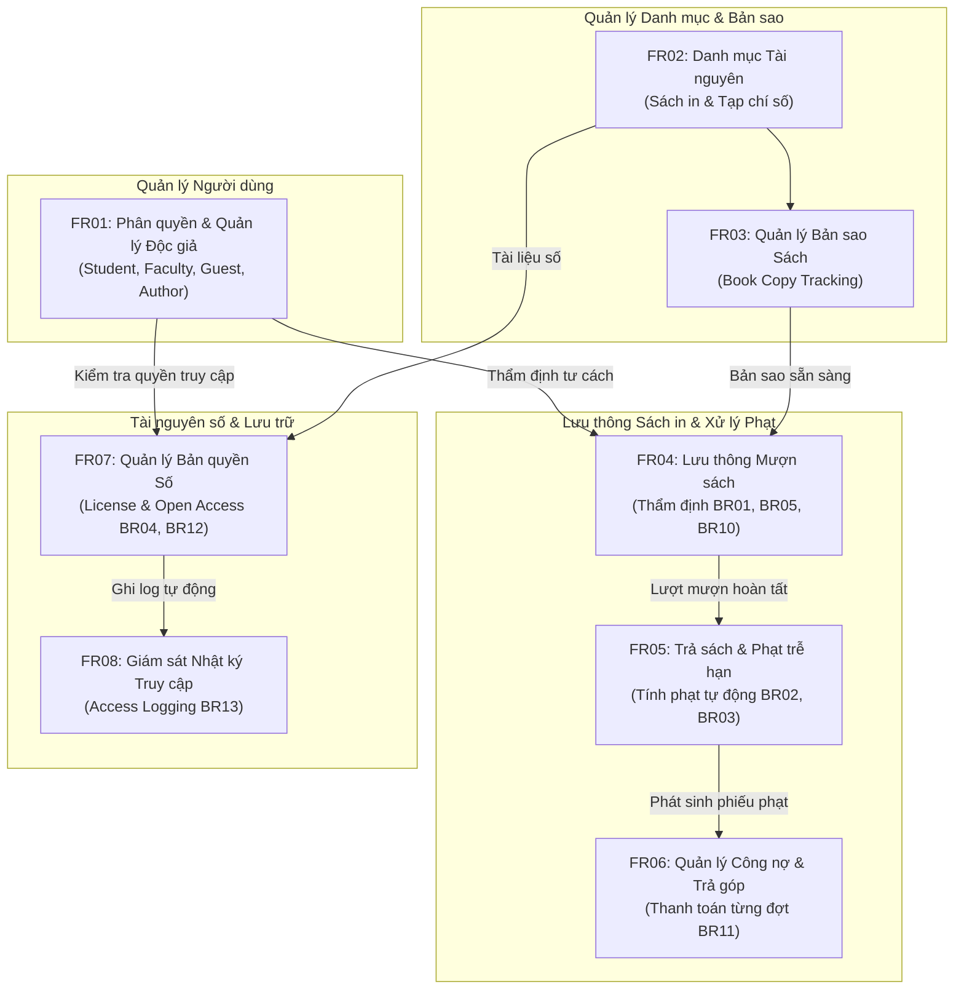
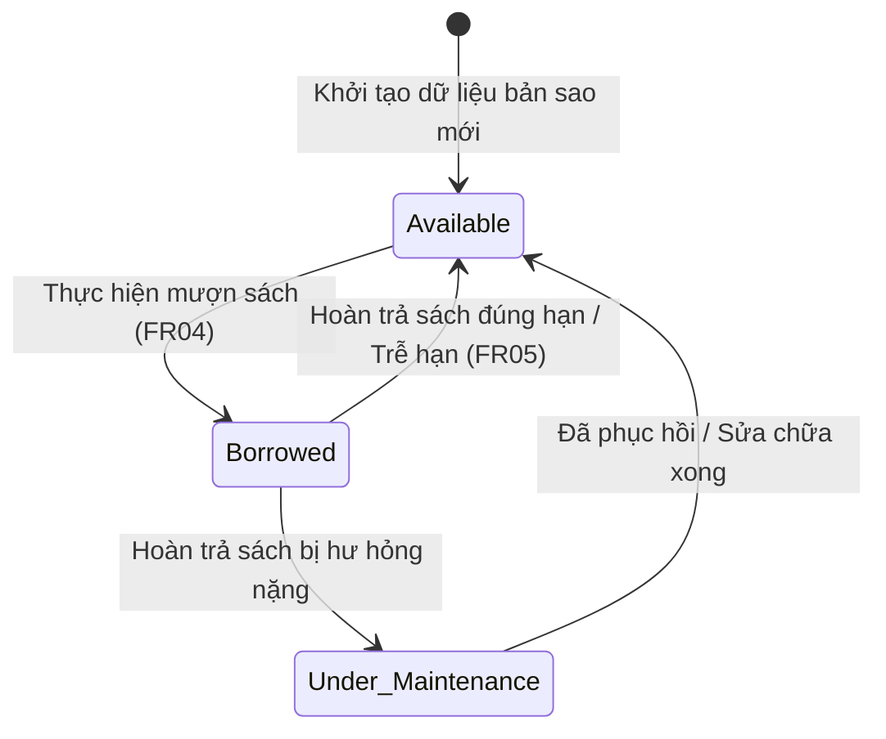
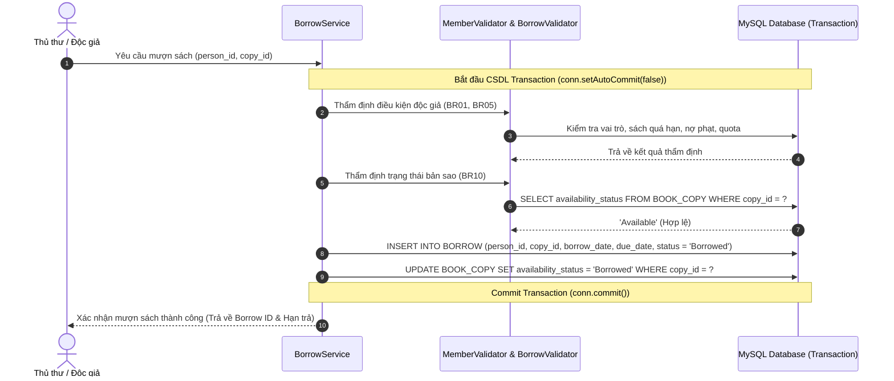
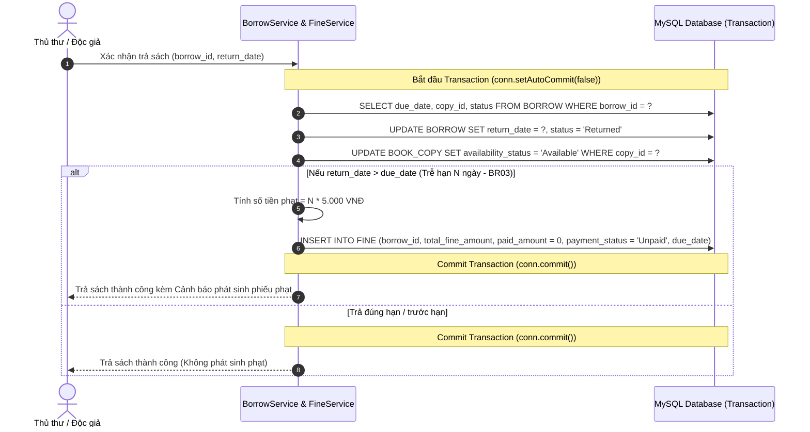
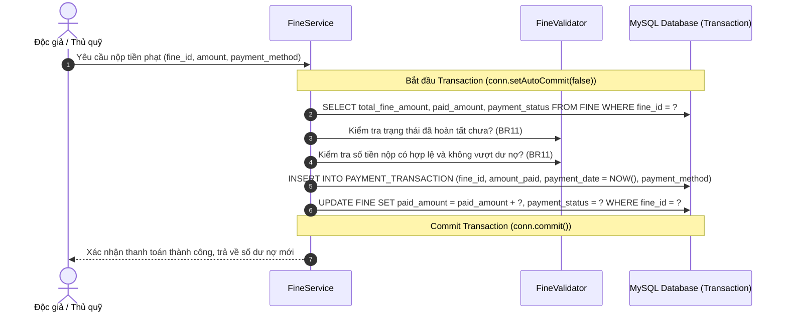
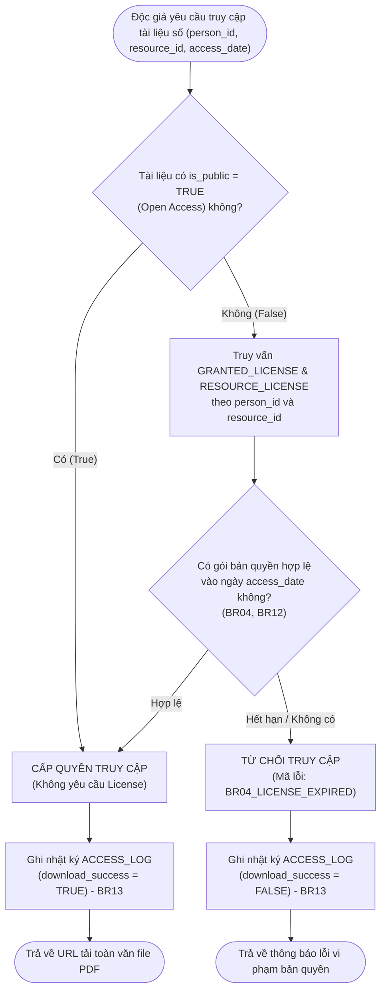

# ĐẶC TẢ CHI TIẾT LUỒNG HOẠT ĐỘNG CÁC CHỨC NĂNG NGHIỆP VỤ (FR01 - FR08)
**Dự án:** Hệ thống Quản lý Thư viện số & Lưu trữ mở (*Digital Library Management System & Open Repository*)  
**Tài liệu đối chiếu:** `Source/G5_phase1.pdf` / `Source/G5_phase1.txt` (SRS Phase 1)  
**Mã nguồn đối chiếu:** `Project/src/com/library/` & CSDL `library_db`

---

## 1. Khái quát Hệ thống & Triết lý Thiết kế Luồng Nghiệp vụ

Hệ thống Quản lý Thư viện số và Lưu trữ mở được thiết kế nhằm đồng bộ hóa quy trình quản lý giữa **tài nguyên vật lý** (sách in truyền thống, quản lý theo từng bản sao/mã vạch) và **tài nguyên số** (tạp chí, bài báo khoa học có gắn mã DOI và quản lý gói bản quyền).

Theo tài liệu đặc tả **SRS Phase 1 (G5_phase1)**, hệ thống không đặt trọng tâm vào các chức năng nhập liệu danh mục tĩnh đơn thuần (CRUD cơ bản) vì các dữ liệu danh mục ban đầu (Master Data: danh sách sách, thành viên, bản sao, gói bản quyền) được khởi tạo và kiểm soát cấu trúc trực tiếp qua kịch bản cơ sở dữ liệu (`schema.sql`, `sample_data.sql`) và mã nguồn khởi tạo (`DatabaseInitializer.java`). Trọng tâm cốt lõi của hệ thống là **các luồng giao dịch nghiệp vụ thực thi (Operational & Transactional Flows)** bảo đảm toàn vẹn dữ liệu và kiểm soát nghiêm ngặt 13 Quy chế Nghiệp vụ (**BR01 đến BR13**).

---

## 2. Chi tiết Luồng Hoạt động Của Từng Chức năng (FR01 đến FR08)

---

### FR01: User Management (Quản lý Người Dùng & Phân Quyền Độc Giả)

#### 1. Mục tiêu & Thực thể liên quan
- **Mục tiêu**: Quản lý thông tin định danh cá nhân và phân cấp quyền hạn theo từng nhóm đối tượng sử dụng thư viện.
- **Thực thể CSDL**:
  - `PERSON` (Khóa chính `person_id`, CCCD `ssn`, `name`, `email`, `phone`, `person_type`).
  - `UNIVERSITY_MEMBER` (Khóa phụ kế thừa `person_id`, `member_id`, `department`, `member_type`: `STUDENT` hoặc `FACULTY`, `major`, `academic_rank`).
  - `EXTERNAL_AUTHOR` (Tác giả ngoài kế thừa `person_id`, `organization`).

#### 2. Quy chế Nghiệp vụ chi phối
- **BR01 (Eligible Borrowers)**: Chỉ thành viên chính thức của trường đại học (`STUDENT`, `FACULTY`) mới được phép tạo giao dịch mượn sách vật lý về nhà. Khách vãng lai (`GUEST`) và tác giả ngoài (`EXTERNAL_AUTHOR`) chỉ được đọc tại chỗ hoặc tra cứu tài liệu mở.
- **BR05 (Borrow Eligibility & Quota)**: Độc giả chỉ được phép mượn sách khi đáp ứng đồng thời 3 điều kiện:
  1. Không có sách mượn nào đang trong tình trạng trễ hạn.
  2. Không có phiếu phạt nào quá hạn chưa thanh toán.
  3. Tổng số lượng sách đang mượn hiện tại chưa chạm ngưỡng tối đa (Hạn mức: Sinh viên tối đa 3 cuốn, Giảng viên tối đa 5 cuốn).
- **BR09 (Authorship Attribution)**: Mọi tài nguyên trong thư viện phải liên kết với ít nhất một tác giả thông qua quan hệ `AUTHOR_OF`.

#### 3. Luồng Hoạt động (Operational Flow)
1. Hệ thống tiếp nhận yêu cầu tra cứu hoặc thẩm định độc giả qua `person_id`.
2. Truy vấn kết hợp `PERSON` LEFT JOIN `UNIVERSITY_MEMBER`.
3. Kiểm tra vai trò: Nếu không phải `STUDENT` hoặc `FACULTY`, xác định vi phạm `BR01` (Ineligible Member).
4. Kiểm tra lịch sử mượn trong bảng `BORROW`: Đếm số sách đang mượn (`status = 'Borrowed'`), kiểm tra có lượt mượn nào có `due_date < CURRENT_DATE` hay không (Vi phạm quá hạn `BR05`).
5. Kiểm tra bảng `FINE`: Kiểm tra có phiếu phạt nào có `payment_status != 'Completed'` và `due_date < CURRENT_DATE` hay không (Vi phạm nợ phạt `BR05`).
6. Trả về trạng thái hợp lệ hoặc ném ngoại lệ tương ứng (`IneligibleMemberException`, `OverdueBooksPendingException`, `OutstandingFineException`, `BorrowQuotaExceededException`).

---

### FR02: Resource Management (Quản lý Danh Mục Tài Nguyên Thư Viện)

#### 1. Mục tiêu & Thực thể liên quan
- **Mục tiêu**: Quản lý danh mục tài nguyên tri thức gồm hai phân nhánh riêng biệt: Sách in vật lý và Tạp chí/Bài báo số.
- **Thực thể CSDL**:
  - `RESOURCE` (Superclass: `resource_id`, `title`, `publish_date`, `topic`, `resource_type`: `'PHYSICAL_BOOK'` hoặc `'DIGITAL_JOURNAL'`).
  - `PHYSICAL_BOOK` (Subclass: `resource_id`, `isbn`).
  - `DIGITAL_JOURNAL` (Subclass: `resource_id`, `doi`, `url`, `file_size`, `format`, `is_public`).
  - `AUTHOR_OF` & `PERSON`: Liên kết tác giả sáng tác tài nguyên.

#### 2. Quy chế Nghiệp vụ chi phối
- Tài nguyên sách vật lý được theo dõi tồn kho và lưu thông thông qua các bản sao cá thể (`BOOK_COPY`).
- Tài nguyên số không có bản sao vật lý mà được quản lý bằng liên kết định danh toàn cầu DOI và liên kết cấp phép bản quyền (`RESOURCE_LICENSE`).
- Hỗ trợ cờ `is_public` (Open Access) cho phép tài liệu mở được đọc công khai mà không bị ràng buộc gói bản quyền thương mại.

#### 3. Luồng Hoạt động (Operational Flow)
1. Tiếp nhận từ khóa tìm kiếm (theo tên sách, chủ đề, mã ISBN hoặc mã DOI) và bộ lọc phân loại (`ALL`, `PHYSICAL_BOOK`, `DIGITAL_JOURNAL`).
2. Thực thi truy vấn kết hợp:
   - `RESOURCE` LEFT JOIN `PHYSICAL_BOOK` LEFT JOIN `DIGITAL_JOURNAL`.
   - Kết hợp bảng `BOOK_COPY` (gom nhóm theo `resource_id`) để tính toán tức thời: Tổng số bản sao (`COUNT(copy_id)`) và số bản sao khả dụng (`COUNT(CASE WHEN availability_status = 'Available' THEN 1 END)`).
3. Đóng gói dữ liệu hiển thị kèm nhãn phân định (Sách in, Tạp chí số cần License, Tạp chí số Open Access).

---

### FR03: Copy Tracking (Quản lý Bản Sao Sách Vật Lý)

#### 1. Mục tiêu & Thực thể liên quan
- **Mục tiêu**: Định danh và theo dõi trạng thái vật lý của từng cuốn sách cụ thể trên kệ sách thư viện.
- **Thực thể CSDL**:
  - `BOOK_COPY` (`copy_id`, `resource_id`, `barcode`, `shelf_location`, `availability_status`, `condition_status`).

#### 2. Quy chế Nghiệp vụ chi phối
- **BR10 (Copy Availability Validation)**: Chỉ những bản sao có trạng thái `availability_status = 'Available'` mới được đưa vào danh sách cho phép bạn đọc mượn. Bản sao đang ở trạng thái `'Borrowed'` hoặc `'Under Maintenance'` bị hệ thống khóa tự động.
- Mỗi bản sao được định danh duy nhất bằng một mã vạch (`barcode`) và vị trí kệ sách (`shelf_location`).

#### 3. Biểu đồ Chuyển Trạng Thái Bản Sao Sách

---

### FR04: Borrow Execution (Quản lý Lưu Thông Mượn Sách)

#### 1. Mục tiêu & Thực thể liên quan
- **Mục tiêu**: Tiếp nhận yêu cầu mượn sách, thẩm định điều kiện độc giả và tình trạng sách, thiết lập kỳ hạn trả và khóa bản sao trong CSDL.
- **Thực thể CSDL**:
  - `BORROW` (`borrow_id`, `person_id`, `copy_id`, `borrow_date`, `due_date`, `return_date`, `status`).
  - `BOOK_COPY`, `PERSON`.

#### 2. Quy chế Nghiệp vụ chi phối
- **BR01**: Chặn nếu độc giả là `GUEST` hoặc `EXTERNAL_AUTHOR`.
- **BR05**: Chặn nếu độc giả đang có sách quá hạn, đang nợ phiếu phạt quá hạn, hoặc số sách đang giữ đạt hạn mức (Quota $\ge 3$ cuốn).
- **BR10**: Chặn nếu bản sao sách không ở trạng thái `'Available'`.
- **BR02 (Standard Borrow Duration)**: Hạn trả tiêu chuẩn (`due_date`) được tính tự động bằng ngày mượn cộng thêm 14 ngày (`due_date = borrow_date + 14 days`).

#### 3. Luồng Giao Dịch ACID (Connection chung)

---

### FR05: Fine Management & Trả Sách (Xử Lý Trả Sách & Phát Sinh Phiếu Phạt)

#### 1. Mục tiêu & Thực thể liên quan
- **Mục tiêu**: Ghi nhận thời điểm hoàn trả sách thực tế, giải phóng bản sao sách về trạng thái sẵn sàng, và tự động phát sinh phiếu phạt nếu vi phạm trễ hạn.
- **Thực thể CSDL**:
  - `BORROW` (cập nhật `return_date`, `status = 'Returned'`).
  - `BOOK_COPY` (cập nhật `availability_status = 'Available'`).
  - `FINE` (`fine_id`, `borrow_id`, `total_fine_amount`, `paid_amount`, `payment_status`, `due_date`).

#### 2. Quy chế Nghiệp vụ chi phối
- **BR02**: Đánh dấu ngày trả sách thực tế `return_date`.
- **BR03 (Late Return Penalty Calculation)**:
  - Nếu `return_date > due_date`: Hệ thống xác định độc giả trả trễ $N$ ngày ($N = \text{return\_date} - \text{due\_date}$).
  - Số tiền phạt trễ hạn được tính tự động theo công thức:
    $$\text{total\_fine\_amount} = N \times 5.000\text{ VNĐ}$$
  - Tự động tạo bản ghi mới trong bảng `FINE` với `total_fine_amount`, `paid_amount = 0`, `payment_status = 'Unpaid'`, và hạn tất toán tiền phạt `due_date = return_date + 14 days`.
- **BR10**: Khôi phục trạng thái bản sao sách về `'Available'` để người khác có thể mượn tiếp.

#### 3. Luồng Giao Dịch ACID Hoàn Trả & Phạt

---

### FR06: Payment Transaction (Quản lý Công Nợ & Thu Tiền Phạt Trả Góp)

#### 1. Mục tiêu & Thực thể liên quan
- **Mục tiêu**: Thu tiền phạt trễ hạn, hỗ trợ thanh toán linh hoạt từng đợt (trả góp), đối soát số dư nợ còn lại và cập nhật trạng thái phiếu phạt.
- **Thực thể CSDL**:
  - `FINE` (`fine_id`, `total_fine_amount`, `paid_amount`, `payment_status`).
  - `PAYMENT_TRANSACTION` (`transaction_id`, `fine_id`, `amount_paid`, `payment_date`, `payment_method`: `'Cash'`, `'Bank Transfer'`, `'Credit Card'`).

#### 2. Quy chế Nghiệp vụ chi phối
- **BR11 (Installment Fine Settlement)**:
  - Cho phép người dùng thanh toán tiền phạt làm nhiều đợt.
  - Số tiền thanh toán mỗi lần $\text{amount} > 0$ và không được vượt quá số dư nợ còn lại:
    $$\text{remaining\_balance} = \text{total\_fine\_amount} - \text{paid\_amount}$$
  - Mỗi lần thanh toán tạo một bản ghi `PAYMENT_TRANSACTION`.
  - Cập nhật lũy kế `paid_amount = paid_amount + amount` trong bảng `FINE`.
  - Nếu `paid_amount == total_fine_amount`: Chuyển `payment_status = 'Completed'`.
  - Nếu `paid_amount < total_fine_amount`: Chuyển `payment_status = 'Partially Paid'`.
  - Nghiêm cấm thanh toán đối với phiếu phạt đã ở trạng thái `'Completed'` (Ném `FineAlreadySettledException`).

#### 3. Luồng Giao Dịch ACID Thanh Toán Trả Góp

---

### FR07: Digital License Management (Quản lý Bản Quyền & Thẩm Định Quyền Đọc Số)

#### 1. Mục tiêu & Thực thể liên quan
- **Mục tiêu**: Kiểm soát quyền truy cập trực tuyến đối với các tài liệu số, bảo đảm quyền sở hữu trí tuệ của nhà xuất bản.
- **Thực thể CSDL**:
  - `DIGITAL_JOURNAL` (`resource_id`, `doi`, `url`, `is_public`).
  - `LICENSE_PACKAGE` (`package_id`, `package_name`, `provider`, `start_date`, `end_date`).
  - `RESOURCE_LICENSE` (`package_id`, `resource_id`).
  - `GRANTED_LICENSE` (`grant_id`, `package_id`, `person_id`, `granted_date`, `expiry_date`).

#### 2. Quy chế Nghiệp vụ chi phối
- **Open Access (Tài liệu công khai)**: Nếu tạp chí có cờ `is_public = TRUE`, mọi đối tượng bạn đọc (kể cả khách ngoài `GUEST`) đều được phép đọc và tải toàn văn mà không cần bất kỳ gói bản quyền nào.
- **BR04 & BR12 (Active License Enforcement)**: Đối với tạp chí có bản quyền thương mại (`is_public = FALSE`), người dùng bắt buộc phải sở hữu gói bản quyền (`GRANTED_LICENSE`) thỏa mãn:
  $$\text{granted\_date} \le \text{access\_date} \le \text{expiry\_date}$$
  đồng thời gói bản quyền đó phải chứa tài nguyên cần đọc (`RESOURCE_LICENSE`). Nếu không thỏa mãn, hệ thống từ chối truy cập và ném ngoại lệ `LicenseExpiredException`.

#### 3. Biểu đồ Luồng Thẩm Định Bản Quyền Số

---

### FR08: Access Logging (Giám Sát & Nhật Ký Truy Cập Tài Liệu Số)

#### 1. Mục tiêu & Thực thể liên quan
- **Mục tiêu**: Lưu vết toàn bộ lịch sử tương tác với tài nguyên số để phục vụ thống kê lượt đọc, kiểm toán an ninh và phát hiện các hành vi quét dữ liệu trái phép.
- **Thực thể CSDL**:
  - `ACCESS_LOG` (`log_id`, `access_timestamp`, `ip_address`, `download_success`, `person_id`, `resource_id`).

#### 2. Quy chế Nghiệp vụ chi phối
- **BR13 (High-throughput Audit Logging)**:
  - Bảng `ACCESS_LOG` phải ghi nhận mọi lượt yêu cầu truy cập, **bất kể yêu cầu đó được cấp quyền thành công hay bị từ chối**.
  - **Tối ưu hóa kiến trúc CSDL**: Bảng `ACCESS_LOG` được thiết kế **không sử dụng khóa ngoại cứng (`FOREIGN KEY`)** liên kết sang bảng `PERSON` và `RESOURCE`. Điều này loại bỏ hoàn toàn chi phí khóa bảng (Lock contention) và kiểm tra toàn vẹn tham chiếu chéo, bảo đảm tốc độ ghi dữ liệu cực nhanh (High Write Throughput) đáp ứng tải cao khi có hàng nghìn bạn đọc tải tài liệu đồng thời.

#### 3. Luồng Hoạt động (Operational Flow)
1. Khi có bất kỳ request thẩm định tài liệu số nào được gửi đến từ `FR07`:
2. Hệ thống trích xuất thông tin: `person_id`, `resource_id`, địa chỉ IP người dùng (`ip_address`), thời gian hiện tại (`access_timestamp`), và kết quả thẩm định (`download_success`: `1` nếu thành công, `0` nếu bị chặn).
3. Thực thi câu lệnh `INSERT INTO ACCESS_LOG` độc lập với luồng đọc file.
4. Giao diện quản trị cho phép tra cứu bảng nhật ký thời gian thực kết hợp JOIN mềm hiển thị tên độc giả và tiêu đề tài nguyên.

---

## 3. Bảng Tổng Hợp Ánh Xạ Quy Chế Nghiệp Vụ (BR01 - BR13) Với Các FR

| Quy chế (BR) | Tên quy định nghiệp vụ | Mã chức năng chi phối | Tầng mã nguồn hiện thực |
| :--- | :--- | :--- | :--- |
| **BR01** | Eligible Borrowers (Chỉ thành viên nội bộ được mượn sách) | **FR01, FR04** | `MemberValidator`, `MemberService` |
| **BR02** | Standard Borrow Duration (Hạn mượn chuẩn 14 ngày & Hoàn tất trả) | **FR04, FR05** | `BorrowValidator`, `BorrowService` |
| **BR03** | Late Return Penalty (Phạt trễ hạn 5.000 VNĐ / ngày) | **FR05** | `BorrowService`, `FineRepository` |
| **BR04** | Licensed Resource Access (Truy cập tạp chí số phải có bản quyền) | **FR07** | `LicenseValidator`, `DigitalJournalService` |
| **BR05** | Borrow Eligibility & Quota (Chặn khi quá hạn, nợ phạt, quá quota) | **FR01, FR04** | `MemberValidator`, `MemberService` |
| **BR06** | Damaged Material Penalty (Bồi thường hư hại sách) | **FR05** | Mô hình `BOOK_COPY.condition_status` |
| **BR07** | Resource Types (Phân biệt sách in và tạp chí số) | **FR02** | `ResourceRepository`, `PHYSICAL_BOOK`, `DIGITAL_JOURNAL` |
| **BR08** | Unique Transaction Code (Định danh giao dịch thanh toán) | **FR06** | `PAYMENT_TRANSACTION.transaction_id` |
| **BR09** | Authorship Attribution (Tài nguyên phải có tác giả) | **FR01, FR02** | `AUTHOR_OF` quan hệ liên kết CSDL |
| **BR10** | Copy Availability (Bản sao phải Available mới được mượn) | **FR03, FR04** | `BorrowValidator`, `BorrowRepository` |
| **BR11** | Installment Fine Settlement (Cho phép trả góp tiền phạt) | **FR06** | `FineValidator`, `FineService` |
| **BR12** | Active License Package (Gói bản quyền phải còn trong thời hạn) | **FR07** | `LicenseValidator`, `GrantedLicenseRepository` |
| **BR13** | High-throughput Audit Logging (Ghi log không dùng khóa ngoại) | **FR08** | `AccessLogRepository`, `ACCESS_LOG` schema |
